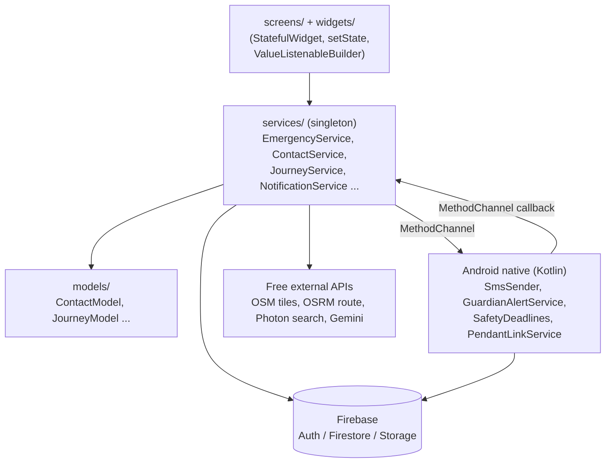

# ১. প্রজেক্ট পরিচিতি ও ২. Technology Stack

> এই ফাইলের প্রতিটি তথ্য বর্তমান workspace-এর code থেকে নেওয়া। প্রতিটি দাবির শেষে `[source: ...]` দেওয়া আছে। line নম্বরগুলো আনুমানিক (`~`), কারণ ফাইল সম্পাদনা হলে কয়েক লাইন সরে যেতে পারে।

---

## ১. প্রজেক্ট পরিচিতি

### ১.১ নাম ও পরিচয়

| বিষয় | মান | উৎস |
|---|---|---|
| App-এর প্রদর্শিত নাম | **Woman Guard** | `[source: android/app/src/main/AndroidManifest.xml, <application android:label>, line ~49]`, `[source: lib/main.dart, SmartSafetyApp.build(), line ~168]` |
| Dart/Flutter project নাম | `smart_safety` | `[source: pubspec.yaml, name, line 1]` |
| pubspec description | `Woman Guard - A Smart Women Safety System Flutter Application` | `[source: pubspec.yaml, line 2]` |
| Version | `1.0.0+1` | `[source: pubspec.yaml, line 4]` |
| Android package / applicationId | `com.smartsafety.smart_safety` | `[source: android/app/build.gradle.kts, defaultConfig.applicationId, line ~29]` |
| iOS bundle id (Firebase options-এ) | `com.smartsafety.smartSafety` | `[source: lib/firebase_options.dart, DefaultFirebaseOptions.ios, line ~66]` |
| Firebase project id | `womens-safety-aa3ef` | `[source: firebase.json, line ~6]` |
| Welcome screen-এর tagline | `Alert the people you trust in one tap,\nwith or without the ESP32 device.` | `[source: lib/screens/welcome_screen.dart, _WelcomeScreenState.build(), line ~138]` |

### ১.২ উদ্দেশ্য — কোন real-life সমস্যা সমাধান করে

বাংলাদেশে একজন নারী রাস্তায়, রিকশা/CNG/Uber-এ, বা রাতে একা বাড়ি ফেরার পথে বিপদে পড়লে সাধারণত ফোন আনলক করে, কাউকে খুঁজে কল করা — এতে অনেক সময় লাগে, আর অপরাধী সামনে থাকলে কল করাও বিপজ্জনক। Woman Guard এই সমস্যাগুলোর জন্য code-এ নিচের সমাধানগুলো রেখেছে:

1. **এক tap-এ SOS** — home screen-এর লাল SOS বোতামে একবার চাপলেই (কোনো countdown ছাড়া) location সহ SMS ও in-app alert যায়। `[source: lib/screens/home_screen.dart, _SOSButtonState.build() → GestureDetector(onTap: widget.onPressed), line ~2347]`, `[source: lib/screens/home_screen.dart, _HomeScreenState._onSOSPressed(), line ~212]`
2. **Internet ছাড়াও কাজ করে** — SOS SMS ফোনের নিজের SIM থেকে সরাসরি যায় (Android native `SmsManager`), internet লাগে না। `[source: android/app/src/main/kotlin/com/smartsafety/smart_safety/SmsSender.kt, SmsSender.dispatch(), line ~138]`
3. **গোপন (silent) SOS** — Duress PIN দিলে app একটা calculator-এ রূপ নেয় আর চুপচাপ SOS পাঠায়। `[source: lib/services/pin_security_service.dart, PinSecurityService.triggerDuressPipeline(), line ~269]`
4. **হার্ডওয়্যার বোতাম (ESP32 pendant)** — ফোন পকেটে থাকলেও pendant-এর বোতাম চাপলে SOS যায়। `[source: android/app/src/main/kotlin/com/smartsafety/smart_safety/PendantLinkService.kt, PendantLinkService.triggerSos(), line ~503]`
5. **Ride Safety Check-in** — CNG/Uber/Pathao-তে ওঠার সময় গাড়ির number plate (বাংলা/ইংরেজি) OCR দিয়ে পড়ে guardian-দের জানায়, সময়মতো না পৌঁছালে স্বয়ংক্রিয় SOS। `[source: lib/services/ride_checkin_service.dart, RideCheckinService.startRideCheckin(), line ~99]`
6. **Safe Journey / Followed Mode** — যাত্রাপথে নজরদারি, "Are you OK?" check-এ ৬০ সেকেন্ডে সাড়া না দিলে স্বয়ংক্রিয় SOS। `[source: lib/services/journey_service.dart, JourneyService._triggerSafetyCheck(), line ~933]`

### ১.৩ Target user

Code থেকে দুই ধরনের user বোঝা যায়:
- **Protected user (সুরক্ষিত ব্যক্তি)** — যিনি SOS পাঠান। তিনি contacts যোগ করেন। `[source: lib/services/contact_sync_service.dart, ContactSyncService.sendConnectionRequest(), line ~430]`
- **Guardian (অভিভাবক)** — যিনি request accept করে alert পান। Code-এ এটা "one-way link": request যে পাঠায় সে protected, যে accept করে সে guardian। `[source: lib/services/contact_sync_service.dart, class doc comment, line ~12-17]`
- **Guest** — sign-in না করে app দেখতে পারেন, কিন্তু SOS, Safe Journey, Followed Mode, Ride Check-in চালাতে sign-in লাগে। `[source: lib/utils/auth_guard.dart, AuthGuard.run(), line ~19]`, `[source: lib/screens/home_screen.dart, _onSOSPressed() → AuthGuard.run, line ~231]`

### ১.৪ এক নজরে সব feature (status সহ)

চিহ্ন: ✅ = সম্পূর্ণ implemented ও UI থেকে চালু করা যায় (code trace করা হয়েছে); ⚠️ = আংশিক / gap আছে / device-এ test প্রয়োজন; ❌ = শুধু উল্লেখ আছে, code-এ কাজ করে না।

| # | Feature | Status | মূল ফাইল |
|---|---|---|---|
| 1 | Google Sign-In ও Guest mode | ✅ (Android) / ⚠️ iOS | `lib/services/auth_service.dart` |
| 2 | One-tap SOS (SMS + in-app cloud alert + live tracking) | ✅ (Android) | `lib/services/emergency_service.dart` |
| 3 | Native dual-SIM SMS sender + Messages-app fallback | ✅ Android only | `SmsSender.kt`, `native_sms_service.dart` |
| 4 | Follow-up SMS যখন পরে GPS fix আসে | ✅ | `EmergencyService._sendLocationFollowUp()` |
| 5 | Re-send / Re-ring active SOS, "I'm safe" | ✅ | `EmergencyService.resendActiveAlert()`, `markSafe()` |
| 6 | Emergency contacts (registered user / email invite / offline-only) | ✅ | `contact_service.dart`, `contact_sync_service.dart` |
| 7 | Consent-based guardian request (accept/reject), "People I Protect" | ✅ | `contact_sync_service.dart`, `guardian_link_logic.dart` |
| 8 | Primary contact ও Backup contact | ✅ | `ContactService.setPrimaryContact()`, `ContactModel.isBackup` |
| 9 | Guardian-side alert receiver (background native service, siren, full-screen) | ✅ Android only | `GuardianAlertService.kt`, `notification_service.dart` |
| 10 | Live location tracking (throttled Firestore writes) | ✅ | `live_tracking_service.dart` |
| 11 | Smart SOS Escalation (3 min backup contacts alert) | ✅ | `sos_escalation_service.dart` |
| 12 | Incident Room (timeline, map, acknowledge, Call 999) | ✅ | `incident_room_screen.dart`, `incident_service.dart` |
| 13 | Safe Journey (route, ETA, deviation/inactivity/delay check) | ✅ | `journey_service.dart`, `start_journey_sheet.dart` |
| 14 | "I'm Being Followed" mode (৫ মিনিট পরপর silent check-in, nearest police) | ✅ | `journey_service.dart`, `followed_mode_screen.dart` |
| 15 | Ride Safety Check-in + plate OCR (ML Kit + Tesseract বাংলা + optional Gemini) | ⚠️ (Gemini key ও Storage console-এ নির্ভরশীল) | `ride_checkin_service.dart`, `ride_ocr_service.dart` |
| 16 | Safety deadlines — app বন্ধ থাকলেও exact alarm দিয়ে SOS | ✅ Android only | `safety_deadline_service.dart`, `SafetyDeadlines.kt` |
| 17 | ESP32 BLE pendant SOS | ✅ Android (native service); ⚠️ iOS | `esp32_ble_service.dart`, `PendantLinkService.kt`, `esp32_firmware/` |
| 18 | Shake to SOS (৩ বার ঝাঁকুনি, ৫ সেকেন্ড countdown) | ✅ (default off) | `shake_sos_service.dart` |
| 19 | Fall detection (৩-stage algorithm, ৩০ সেকেন্ড countdown) | ✅ (default off) | `motion_detection_service.dart` |
| 20 | Loud Siren (alarm stream, max volume) | ✅ | `siren_service.dart`, `AlertSirenPlayer.kt` |
| 21 | Fake Call (বাংলা caller voice / নিজের recording) | ⚠️ (bundled বাংলা clip-গুলো placeholder) | `fake_call_*`, `FakeCallAudio.kt` |
| 22 | Security PIN, Duress PIN, Camouflage calculator | ✅ | `pin_security_service.dart`, `camouflage_calculator_screen.dart` |
| 23 | Critical battery SMS (≤ 10%) | ⚠️ (SOS doc-এ write rules-এ আটকে যায়) | `battery_alert_service.dart` |
| 24 | Safety map: safe zones (186টি), community unsafe-spot report, heatmap, 200 m proximity warning | ⚠️ (Firestore খালি হলে hard-coded demo data দেখায়) | `map_screen.dart`, `safety_report_service.dart`, `safe_zone_repository.dart` |
| 25 | Notification inbox (bell) | ✅ | `inbox_service.dart`, `inbox_screen.dart` |
| 26 | Activity / SOS history, Ride history | ✅ | `activity_service.dart`, `sos_history_screen.dart`, `ride_history_screen.dart` |
| 27 | Profile (phone, blood group, emergency note) + one-number-per-account registry | ✅ | `profile_screen.dart`, `phone_registry_service.dart` |
| 28 | Phone OTP verification | ❌ dead code (কোথাও import হয় না) | `phone_verification_modal.dart`, `phone_verification_service.dart` |
| 29 | FCM push (Cloud Functions দিয়ে) | ❌/⚠️ Spark plan-এ deploy হয় না; app Firestore listener দিয়ে কাজ চালায় | `functions/index.js` |
| 30 | Settings: "Live location sharing" ও "Push notifications" toggle | ❌ UI-only (কোনো service পড়ে না) | `settings_screen.dart` |
| 31 | User Manual screen | ✅ | `user_manual_screen.dart` |

বিস্তারিত ব্যাখ্যা `03_FEATURES_BN.md`-এ।

---

## ২. Technology Stack

### ২.১ Flutter ও Dart version

| বিষয় | মান | উৎস |
|---|---|---|
| pubspec-এর Dart SDK constraint | `'>=3.0.0 <4.0.0'` | `[source: pubspec.yaml, environment.sdk, line ~7]` |
| pubspec.lock-এ resolved SDK requirement | `dart: ">=3.11.0 <4.0.0"`, `flutter: ">=3.41.0"` | `[source: pubspec.lock, sdks]` |
| যে Flutter দিয়ে project বানানো (revision) | `00b0c91f06209d9e4a41f71b7a512d6eb3b9c694`, channel `stable` | `[source: .metadata, line ~7-8]` |
| এই machine-এ installed Flutter (`flutter --version`) | Flutter 3.41.9 • Dart 3.11.5 | command output (read-only) |

> ব্যাখ্যা: pubspec-এ ঢিলা constraint (`>=3.0.0`) থাকলেও যে package version-গুলো lock করা আছে সেগুলোর কারণে বাস্তবে Dart ≥ 3.11 ও Flutter ≥ 3.41 লাগবে।

### ২.২ Firebase services — কোনটা, কেন, কোথায়

| Firebase service | ব্যবহৃত? | কেন | কোথায় (code) |
|---|---|---|---|
| **Firebase Core** | ✅ | Firebase চালু করা | `AuthService.initialize()` → `Firebase.initializeApp(options: DefaultFirebaseOptions.currentPlatform)` `[source: lib/services/auth_service.dart, line ~148]` |
| **Firebase Authentication** (Google provider) | ✅ | Login, uid দিয়ে data আলাদা রাখা, security rules-এ `request.auth` | `AuthService.signInWithGoogle()` → `FirebaseAuth.instance.signInWithCredential()` `[source: lib/services/auth_service.dart, line ~391-409]` |
| **Cloud Firestore** | ✅ (মূল database) | users, contacts, SOS alerts, journeys, rides, reports — সব real-time | ৩০+ ফাইলে; যেমন `SosCloudDispatcher.triggerCloudSos()` `[source: lib/services/sos_cloud_dispatcher.dart, line ~218-221]` |
| **Realtime Database** | ❌ ব্যবহার হয়নি | — | pubspec-এ `firebase_database` নেই `[source: pubspec.yaml]` |
| **Firebase Storage** | ✅ (শুধু Ride Check-in ছবি) | plate photo / screenshot upload | `RideCheckinService.uploadRideImage()` → `ref.putFile()` path `ride_checkins/$userId/$rideId/$filename` `[source: lib/services/ride_checkin_service.dart, line ~76-89]` |
| **Firebase Cloud Messaging (FCM)** | ⚠️ client-side আছে, server-side পাঠানোর কেউ নেই | token সংরক্ষণ, foreground message handle | `NotificationService.init()` → `_fcm.getToken()`, `syncTokenToFirestore()` `[source: lib/services/notification_service.dart, line ~567-584, ~1288]` |
| **Cloud Functions** | ⚠️ code repo-তে আছে, কিন্তু app এর উপর নির্ভর করে না | FCM push পাঠাতে লিখা হয়েছিল | `functions/index.js` (৪টি trigger) — নিজের comment-এ লেখা: "Cloud Functions require the Blaze plan; on Spark the app performs this write itself." `[source: functions/index.js, line ~91]` |
| **Crashlytics** | ✅ | release build-এ crash report | `FirebaseCrashlytics.instance.setCrashlyticsCollectionEnabled(!kDebugMode)` `[source: lib/main.dart, _bootstrap(), line ~83]` |

### ২.৩ Firebase Spark (free) plan-এর কারণে নেওয়া design সিদ্ধান্ত (code থেকে প্রমাণ)

1. **FCM server push-এর বদলে Firestore real-time listener** — Guardian-এর ফোনে native Android foreground service সবসময় `sos_alerts` collection-এ listener খোলা রাখে। Code-এর comment: "There is no server on the Spark plan to send FCM pushes, so this foreground service keeps a Firestore listener open on `sos_alerts`". `[source: android/app/src/main/kotlin/com/smartsafety/smart_safety/GuardianAlertService.kt, class doc, line ~30-37]`
2. **Guardian link লেখা client-side** — accept করলে guardian নিজেই protected user-এর `contacts`-এ নিজের entry লেখে (Cloud Function নয়)। এজন্য security rule-এ `acceptedGuardianOf()` নামের বিশেষ শর্ত রাখা হয়েছে। `[source: lib/services/contact_sync_service.dart, acceptRequest(), line ~796-832]`, `[source: firestore.rules, line ~36-39, ~71-72]`
3. **Throttled location write** — ৩০ সেকেন্ডের আগে কখনো write নয়; ৩০ সেকেন্ড + ২৫ মিটার নড়লে বা ১২০ সেকেন্ড পরপর heartbeat। Comment: "remain comfortably within free Firebase Spark plan write quotas". `[source: lib/services/live_tracking_service.dart, LiveTrackingService.shouldWriteUpdate(), line ~14-19, ~73-95]`
4. **SMS = নিজের SIM থেকে** — Twilio-র মতো paid SMS gateway নেই; `SmsManager` ব্যবহার। `[source: SmsSender.kt, line ~26-33]`
5. **Plate OCR on-device + Gemini free tier** — Cloud Vision নয়; ML Kit (on-device), Tesseract (on-device বাংলা), আর ঐচ্ছিক Gemini API (free key, `--dart-define`)। `[source: lib/services/gemini_plate_reader.dart, class doc, line ~27-33]`
6. **Map tiles OpenStreetMap ও CARTO** — Google Maps SDK (billing key) নয়। `[source: lib/screens/map_screen.dart, line ~23-33]`
7. **Route ও place search** — `routing.openstreetmap.de` ও `photon.komoot.io` (free) `[source: lib/services/route_service.dart, line ~70]`, `[source: lib/services/place_search_service.dart, line ~45]`
8. **Safety report query limit 100** — comment: "limit to 100 for Spark tier efficiency" `[source: lib/services/safety_report_service.dart, getReports(), line ~60-64]`
9. **Guardian link migration** client-side — comment: "Free on Spark: a few reads per sign-in plus at most one write per removed entry." `[source: lib/services/guardian_link_migration_service.dart, line ~17]`

> ⚠️ কোড থেকে নিশ্চিত করা যায়নি — Firebase project আসলে Spark plan-এ কিনা তা Firebase console-এর বিষয়; code-এর comment ও design এটাই নির্দেশ করে।

### ২.৪ State management

এই app-এ **Provider / Riverpod / Bloc / GetX কোনোটাই ব্যবহার হয়নি** (pubspec-এ এগুলোর কোনো package নেই `[source: pubspec.yaml]`)। ব্যবহৃত পদ্ধতি:

1. **Singleton service** — প্রতিটি service-এর একটাই instance: `static final X instance = X._internal();` উদাহরণ: `[source: lib/services/emergency_service.dart, line ~218]`
2. **`ValueNotifier` + `ValueListenableBuilder`** — service-এর ভিতরে reactive state (যেমন `activeAlertIdNotifier`, `contactsNotifier`, `isPlayingNotifier`), UI এগুলো শোনে। উদাহরণ: camouflage পুরো app-এ বদলায় `ValueListenableBuilder<bool>(valueListenable: PinSecurityService.instance.isCamouflageActiveNotifier, ...)` `[source: lib/main.dart, SmartSafetyApp.build(), line ~176-185]`
3. **`ChangeNotifier`** — `ContactService extends ChangeNotifier` `[source: lib/services/contact_service.dart, line ~18]`
4. **`setState`** — screen-এর local UI state (যেমন `_isSOSLoading`) `[source: lib/screens/home_screen.dart, line ~247]`
5. **Firestore `snapshots()` Stream** — real-time data (contacts, alerts, journeys)।

**কেন এই পদ্ধতি:** অনেক state (SOS active কিনা, siren বাজছে কিনা) UI ছাড়াও background কাজ (headless engine, notification callback) থেকে বদলায়; singleton service এগুলো widget tree ছাড়াই access করতে দেয়। (এটি code-এর গঠন থেকে যুক্তি; developer-এর লেখা কোনো ঘোষণা নয়।)

### ২.৫ Architecture pattern ও folder structure

Pattern: **layer-based (type-first) structure — screens / widgets / services / models**। Business logic `services/`-এ, UI `screens/` ও `widgets/`-এ, data class `models/`-এ। এটা কঠোর MVVM বা Clean Architecture নয় (কোনো repository interface / use-case layer নেই); বলা যায় **"Service-oriented MVC-ধাঁচ"** — model, view (screen), আর service (controller + data access একসাথে)।

| Folder | কী আছে | ফাইল সংখ্যা |
|---|---|---|
| `lib/main.dart` | entry point, Firebase/Crashlytics init, headless entry `safetyDeadlineBackgroundMain` | 1 |
| `lib/firebase_options.dart` | FlutterFire-generated Firebase config (Android + iOS) | 1 |
| `lib/core/` | theme, রং, text style, design token (`app_theme.dart`, `app_colors.dart`, `app_text.dart`, `app_tokens.dart`) | 4 |
| `lib/constants/` | বাংলাদেশি number plate-এর শহর/series তালিকা (`bd_plate_constants.dart`) | 1 |
| `lib/models/` | data class: `ContactModel`, `JourneyModel`, `RideCheckinModel`, `UserProfile`, `SafetyReportModel`, `SafeZone`, `ActivityItem`, `IncidentEvent`, `FakeCaller` | 9 |
| `lib/services/` | সব business logic (SOS, contacts, tracking, OCR, BLE, ...) | 41 |
| `lib/screens/` | পূর্ণ পৃষ্ঠা (screen) | 21 |
| `lib/widgets/` | dialog, bottom sheet, card; `widgets/ui/` = ছোট reusable UI | 14 + 5 |
| `lib/utils/` | `auth_guard.dart`, `geohash_helper.dart`, `url_launcher_helper.dart`, `duration_format.dart` | 4 |
| `android/app/src/main/kotlin/...` | **20টি Kotlin ফাইল** — native SMS, guardian listener service, siren, safety deadline alarm, ESP32 BLE link, fake-call audio | 20 |
| `ios/Runner/` | `AppDelegate.swift`, `SceneDelegate.swift`, `Info.plist` | — |
| `functions/` | Node.js Cloud Functions (`index.js`) — Spark-এ deploy হয় না | 1 |
| `esp32_firmware/` | Arduino sketch `esp32_woman_guard_pendant.ino` + README | 2 |
| `assets/` | siren.mp3, logo, বাংলা fake-call clip, safe zone data (json/csv/xlsx), Tesseract বাংলা model `ben.traineddata` | — |
| `test/` | 42টি Dart test ফাইল + 2টি Firestore rules test (`.mjs`, `test/firestore_rules/`) | 44 |
| `scripts/` | `cleanup_sos.js` (Firebase Admin দিয়ে পুরনো SOS মুছতে), `check_siren_calls.sh` | 2 |

**MethodChannel (Flutter ↔ native কথা বলার পথ) তালিকা** — কোডে নামগুলো হুবহু:

| Channel নাম | Dart দিক | Native দিক |
|---|---|---|
| `com.smartsafety.smart_safety/sms` | `NativeSmsService` `[source: lib/services/native_sms_service.dart, line ~33]` | `AppChannels.onSmsCall()` `[source: AppChannels.kt, line ~55]` |
| `com.smartsafety.smart_safety/device` | `SirenService`, `BackgroundServiceManager`, `GuardianAlertService` | `AppChannels.registerShared()` |
| `com.smartsafety.smart_safety/deadline` | `SafetyDeadlineService` `[source: lib/services/safety_deadline_service.dart, line ~151]` | `AppChannels.handleDeadlineCall()` |
| `com.smartsafety.smart_safety/guardian` | `GuardianAlertService` `[source: lib/services/guardian_alert_service.dart, line ~26]` | `MainActivity.onGuardianCall()` `[source: MainActivity.kt, line ~145]` |
| `com.smartsafety.smart_safety/pendant` | `Esp32BleService` `[source: lib/services/esp32_ble_service.dart, line ~165]` | `PendantLink.register()` |
| `com.smartsafety.smart_safety/fake_call` | fake call audio | `MainActivity.configureFlutterEngine()` `[source: MainActivity.kt, line ~111]` |
