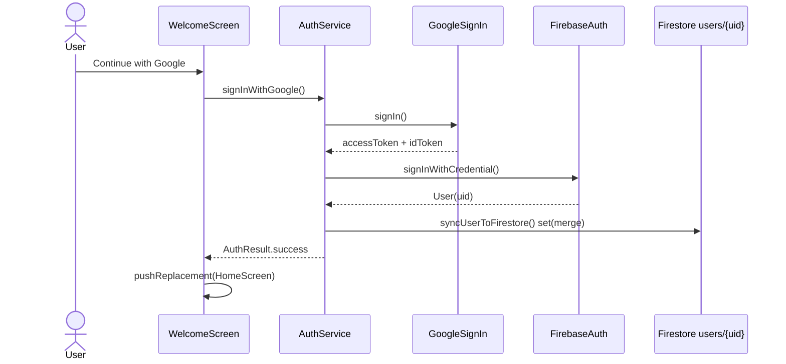
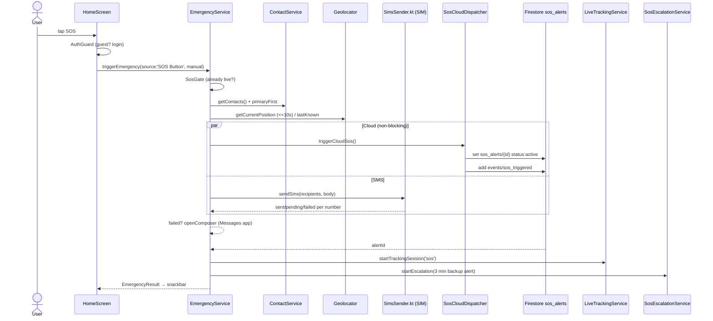
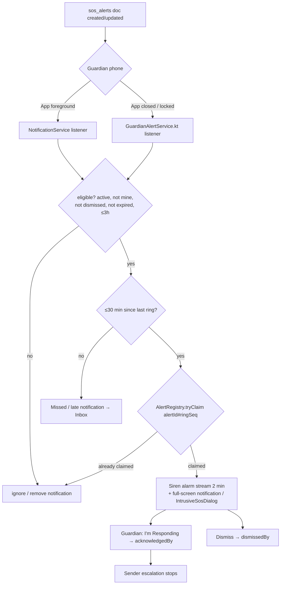
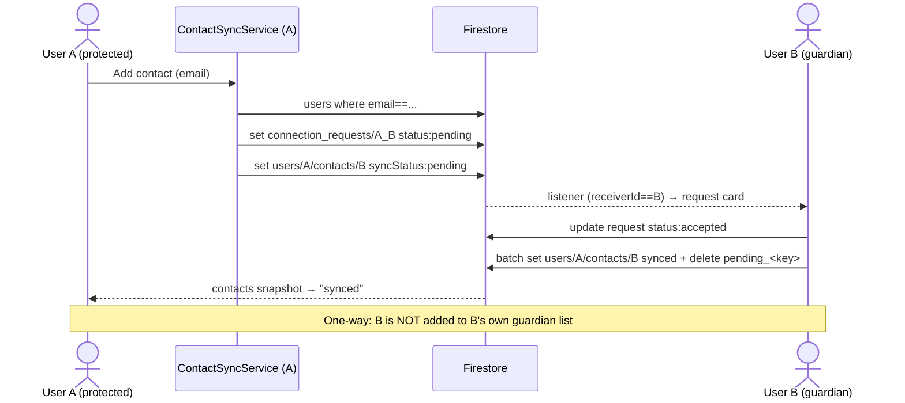
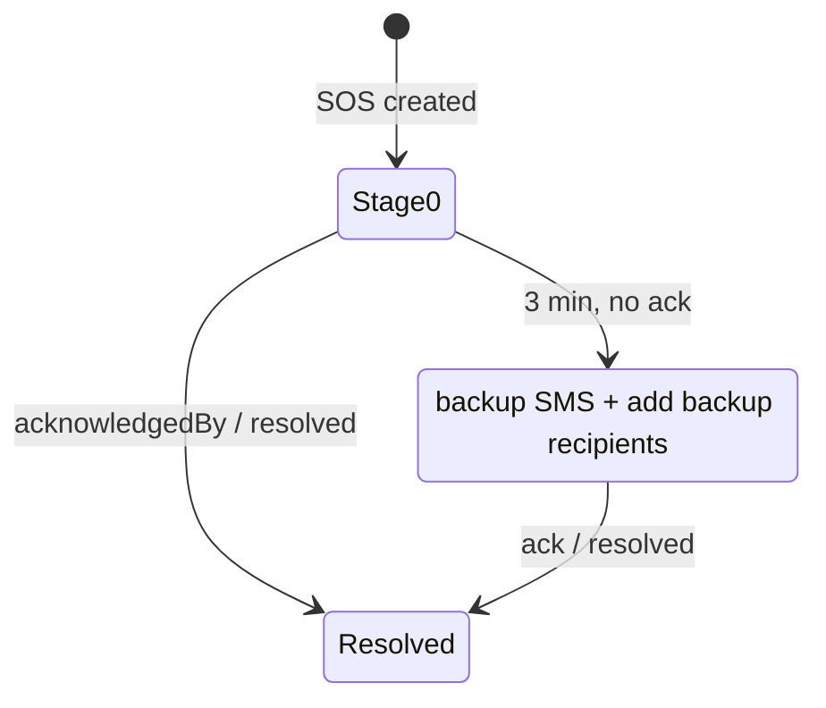
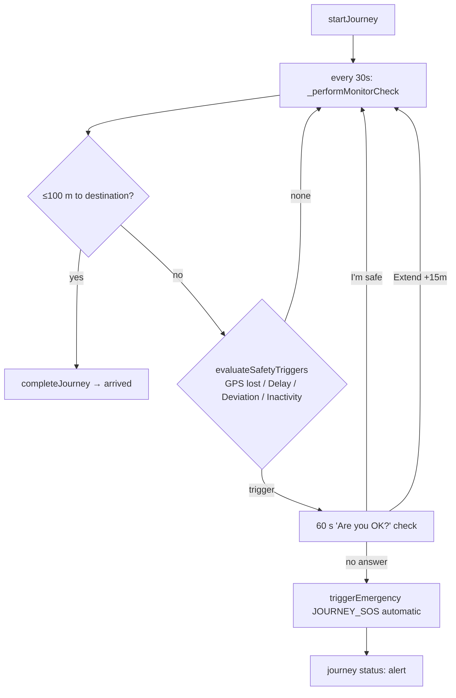
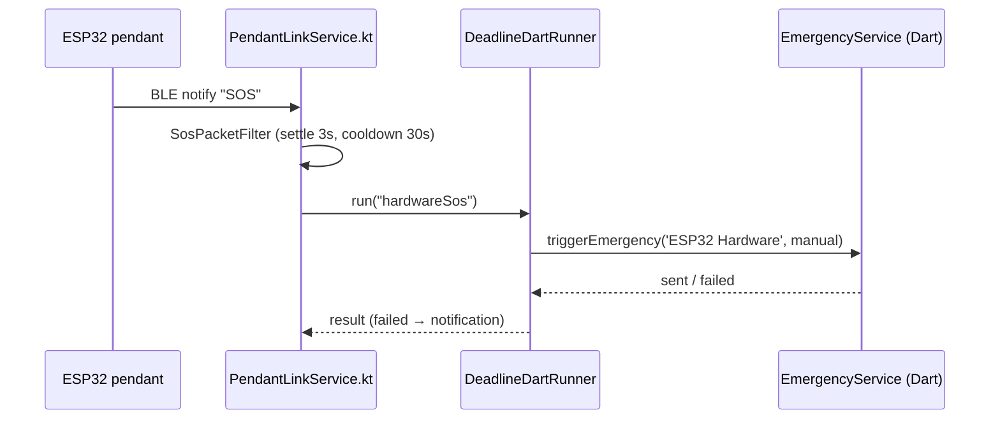

# ৪. প্রতিটি Feature-এর বিস্তারিত ব্যাখ্যা

> প্রতিটি feature UI entry point থেকে শেষ action পর্যন্ত trace করা হয়েছে (grep দিয়ে caller খুঁজে)। line নম্বর আনুমানিক (`~`)। Kotlin ফাইলের পূর্ণ path: `android/app/src/main/kotlin/com/smartsafety/smart_safety/<File>.kt` — নিচে সংক্ষেপে শুধু `<File>.kt` লেখা হয়েছে।

## সূচিপত্র
- [4.1 Authentication (Google Sign-In ও Guest)](#41-authentication-google-sign-in-ও-guest)
- [4.2 SOS Alert — সম্পূর্ণ end-to-end](#42-sos-alert--সম্পূর্ণ-end-to-end)
- [4.3 Guardian-এর দিকে alert গ্রহণ](#43-guardian-এর-দিকে-alert-গ্রহণ)
- [4.4 Emergency Contacts ও Guardian Request](#44-emergency-contacts-ও-guardian-request)
- [4.5 Live Location Tracking](#45-live-location-tracking)
- [4.6 Smart SOS Escalation](#46-smart-sos-escalation)
- [4.7 Incident Room](#47-incident-room)
- [4.8 Safe Journey](#48-safe-journey)
- [4.9 I'm Being Followed mode](#49-im-being-followed-mode)
- [4.10 Ride Safety Check-in ও Plate OCR](#410-ride-safety-check-in-ও-plate-ocr)
- [4.11 Safety Deadlines (app বন্ধ থাকলেও timer)](#411-safety-deadlines-app-বন্ধ-থাকলেও-timer)
- [4.12 ESP32 Pendant (hardware button)](#412-esp32-pendant-hardware-button)
- [4.13 Shake to SOS](#413-shake-to-sos)
- [4.14 Fall Detection](#414-fall-detection)
- [4.15 Loud Siren](#415-loud-siren)
- [4.16 Fake Call](#416-fake-call)
- [4.17 Security PIN, Duress PIN ও Camouflage](#417-security-pin-duress-pin-ও-camouflage)
- [4.18 Critical Battery Alert](#418-critical-battery-alert)
- [4.19 Safety Map, Safe Zones ও Community Reports](#419-safety-map-safe-zones-ও-community-reports)
- [4.20 Notification Inbox](#420-notification-inbox)
- [4.21 Activity/SOS/Ride History](#421-activitysosride-history)
- [4.22 Profile ও Phone Registry](#422-profile-ও-phone-registry)
- [4.23 Settings](#423-settings)
- [4.24 যা code-এ আছে কিন্তু চালু নয়](#424-যা-code-এ-আছে-কিন্তু-চালু-নয়)

---

## 4.1 Authentication (Google Sign-In ও Guest)

**Feature কী:** Google account দিয়ে login, অথবা "Explore as Guest" দিয়ে login ছাড়া app দেখা।

**Real-life সমস্যা:** SOS alert কার পক্ষ থেকে, কাকে পাঠানো হবে — এটা নিশ্চিত করতে প্রতিটি user-এর একটা পরিচয় (uid) দরকার। Security rules-ও uid দেখে data রক্ষা করে।

**User workflow:**
1. App খুললে `WelcomeScreen` দেখায় (logo, "Continue with Google", "Explore as Guest")। `[source: lib/main.dart, SmartSafetyApp.build() → home: const WelcomeScreen(), line ~189]`
2. আগে login করা থাকলে সরাসরি `HomeScreen`-এ চলে যায়। `[source: lib/screens/welcome_screen.dart, initState() → _navigateToHome(), line ~48-50]`
3. "Continue with Google" → Google account বাছাই → `HomeScreen`।
4. "Explore as Guest" → Guest হিসেবে `HomeScreen`। SOS চাপলে `LoginRequiredBottomSheet` আসে।

**Technical workflow:**
1. `main()` → `runZonedGuarded(_bootstrap, ...)` → `AuthService.instance.initialize()` `[source: lib/main.dart, line ~40, ~75]`
2. `initialize()` → `Firebase.initializeApp(options: DefaultFirebaseOptions.currentPlatform)`; তারপর `FirebaseAuth.instance.authStateChanges().listen(...)` — login হলে `ContactService.bindUser(uid)`, `ContactSyncService.initialize()`, `NotificationService.startSosAlertStreamListener()`, `ActivityService.bindUser(uid)`; logout হলে সব purge। `[source: lib/services/auth_service.dart, initialize(), line ~145-217]`
3. `signInWithGoogle()`: `_googleSignIn.signIn()` → `googleUser.authentication` → `GoogleAuthProvider.credential(accessToken, idToken)` → `FirebaseAuth.instance.signInWithCredential(credential)` → `_loadProfileForUser()` → `syncUserToFirestore()` `[source: lib/services/auth_service.dart, line ~391-419]`
4. `syncUserToFirestore()` → `users/{uid}`-এ `set(..., SetOptions(merge: true))` (uid, email lowercase, displayName, photoUrl, phone, lastActiveAt)। `[source: lib/services/auth_service.dart, line ~297-322]`
5. Guest: `continueAsGuest()` → `_isGuestMode = true`, SharedPreferences key `smart_safety_is_guest` = true। `[source: lib/services/auth_service.dart, line ~443-454]`
6. Sign out: `signOut()` → FirebaseAuth + GoogleSignIn sign out, image cache clear, contacts/activity purge, legacy prefs মুছে ফেলা। `[source: lib/services/auth_service.dart, line ~458-506]`

**ব্যবহৃত package/method:** `google_sign_in` (`GoogleSignIn.signIn()`), `firebase_auth` (`signInWithCredential`, `authStateChanges`), `cloud_firestore`, `shared_preferences`।

**Firebase data:** `users/{uid}` — `uid, userId, email, email_lowercase, displayName, name, photoUrl, phoneNumber, phone, lastActiveAt` (+ profile save করলে `city, dob, bloodGroup, emergencyNote, isPhoneVerified, fcmToken`)।

**Permissions:** কোনো বিশেষ runtime permission নয়; `INTERNET` (manifest)।

**Edge cases (code যা করে):**
- Firebase init ব্যর্থ → `_isFirebaseInitialized = false`, guest profile; app crash করে না। `[source: auth_service.dart, line ~205-209]`
- User dialog বাতিল করলে → `AuthResult.cancelled()`, কোনো error দেখায় না। `[source: line ~394-397]`
- error string-এ `'10'` বা `ApiException` থাকলে SHA-1 fingerprint-সংক্রান্ত বার্তা দেখায়। `[source: line ~434-437]`

**Limitations:** শুধু Google provider; email/password বা phone login নেই। iOS-এ Google Sign-In-এর জন্য দরকারি URL scheme (`REVERSED_CLIENT_ID`) `ios/Runner/Info.plist`-এ নেই, আর `GoogleService-Info.plist`-ও repo-তে নেই। `[source: ios/Runner/Info.plist]`

**Status:** ✅ Android-এ সম্পূর্ণ। ⚠️ iOS — ⚠️ কোড থেকে নিশ্চিত করা যায়নি (iOS config অসম্পূর্ণ, device test লাগবে)।



---

## 4.2 SOS Alert — সম্পূর্ণ end-to-end

**Feature কী:** লাল SOS বোতামে **একবার tap** করলে (১) GPS location নেওয়া, (২) সব contact-কে নিজের SIM থেকে SMS, (৩) Firestore-এ `sos_alerts` document (app-ব্যবহারকারী guardian-দের জন্য), (৪) live tracking, (৫) foreground service, (৬) escalation timer — সব চালু হয়।

**Real-life scenario:** রাত ১০টায় মিরপুরে রিকশায় একজন নারী টের পান রিকশাচালক অচেনা গলিতে ঢুকছে। তিনি app খুলে SOS চাপেন। মা ও ভাইয়ের ফোনে SMS যায় — "EMERGENCY! Fatima needs help. Live location: https://maps.google.com/?q=... Time: 10:02 PM, 20 Nov 2026"; ভাইয়ের ফোনে (app আছে, guardian) siren বাজে ও full-screen alert আসে।

**User workflow:**
1. Home ট্যাবে বড় লাল SOS বোতাম tap। `[source: lib/screens/home_screen.dart, _SOSButtonState.build(), line ~2346-2347]`
2. Guest হলে login sheet আসে; login না করলে SOS যায় না। `[source: home_screen.dart, _onSOSPressed() → AuthGuard.run(), line ~231-239]`
3. "Sending SOS…" snackbar → ফলাফল snackbar (কতজনকে SMS গেল, in-app alert গেল কিনা)। `[source: home_screen.dart, _executeSOSPipeline(), line ~242-378]`
4. SOS চালু থাকলে আবার বোতাম চাপলে নতুন alert তৈরি হয় না; একটা action sheet আসে (Re-send / I'm safe ইত্যাদি)। "I'm safe" দিতে সবুজ বোতাম **২ সেকেন্ড চেপে ধরে রাখতে হয়**। `[source: home_screen.dart, _onSOSPressed(), line ~224-229]`, `[source: home_screen.dart, _HoldToConfirmButton.holdDuration = Duration(seconds: 2), line ~2928]`

**Technical workflow (code level):**

1. `_executeSOSPipeline()` → `EmergencyService.instance.triggerEmergency(source: 'SOS Button', origin: SosOrigin.manual)` `[source: home_screen.dart, line ~276-277]`
2. `triggerEmergency()` → `_runGate()` → `SosGate.run()`। **SosGate** নিশ্চিত করে: একসাথে একাধিক trigger এলে একটাই run; alert আগে থেকেই live থাকলে manual press = re-ring + SMS আবার, automatic trigger = কিছুই না। `[source: lib/services/emergency_service.dart, SosGate, line ~138-189]`

```dart
  Future<EmergencyResult> _guardedTrigger(
    SosOrigin origin,
    Future<EmergencyResult> Function(String? existingAlertId) pipeline,
    Future<String?> Function(SosOrigin origin) liveAlertId,
  ) async {
    final existing = await liveAlertId(origin);
    if (existing != null) {
      if (origin == SosOrigin.manual) {
        try {
          // Bounded: an offline write never completes, and must not hold up the SMS round.
          await reRing(existing).timeout(const Duration(seconds: 3));
```
`[source: lib/services/emergency_service.dart, SosGate._guardedTrigger(), line ~167-177]`
- লাইন ব্যাখ্যা: `liveAlertId(origin)` — Firestore-এ এখনো live কোনো alert আছে কিনা দেখে; থাকলে এবং চাপটা manual হলে `reRing()` (ringSeq +1) — ৩ সেকেন্ডের বেশি অপেক্ষা করে না, যাতে offline অবস্থায় SMS আটকে না যায়।

3. `_triggerEmergencyImpl()` ধাপসমূহ `[source: emergency_service.dart, line ~646-1062]`:
   - **(a) Contact সংগ্রহ:** `ContactService.instance.getContacts()`; খালি হলে Firestore `users/{uid}/contacts` থেকে ৩ সেকেন্ড timeout-এ recovery। `[line ~666-697]`
   - **(b) Routing:** Primary contact আগে (`ContactService.primaryFirst`)। প্রতিটি contact: phone থাকলে → SMS তালিকা (E.164 format); email থাকলে → `recipientEmails`; `contactUid` থাকলে (এবং `offline_` দিয়ে শুরু না হলে) → `recipientUids`। **Backup contact প্রথম round-এ বাদ** (`if (contact.isBackup) continue;`), তবে শুধু backup থাকলে সবাই যোগ হয়। `[line ~704-762]`
   - **(c) Contact একদম না থাকলে:** `EmergencyResult(isSuccess: false, message: 'No emergency contacts configured. Please add emergency contacts first.', hasNoRecipients: true)` `[line ~769-776]`
   - **(d) GPS:** `_getCurrentLocation()` (মোট ১০ সেকেন্ড সীমা) → high accuracy ৫ সেকেন্ড → medium ৩ সেকেন্ড → `getLastKnownPosition()`। তারপরও না পেলে আবার `getLastKnownPosition()` ২ সেকেন্ড। Location না পেলেও SMS আটকায় না ("Location unavailable")। `[line ~789-817, ~1323-1374]`
   - **(e) SMS text তৈরি:** `buildSosSmsMessage()` `[line ~1240-1255]`
   - **(f) Cloud SOS (non-blocking):** `SosCloudDispatcher.instance.triggerCloudSos(...)` Future হিসেবে শুরু হয়, অপেক্ষা না করে SMS চলে যায়। `[line ~834-847]`
   - **(g) SMS পাঠানো:** `_dispatchOfflineSms()` → SMS permission check (`Permission.sms`, তারপর `telephony.requestSmsPermissions`) → `NativeSmsService.instance.send()` (Android native)। Native না পেলে (iOS/test) `telephony.sendSms()` loop, এবং `+8801…` ↔ `01…` বিকল্প format-এ একবার retry। `[line ~1065-1181]`
   - **(h) Fallback:** permission নেই বা কিছু SMS fail → `NativeSmsService.openComposer()` — default Messages app-এ recipient ও message pre-filled; app background-এ থাকলে notification "Tap to send your SOS SMS"। **Duress-এ এটা কখনো হয় না।** `[line ~929-935]`, `[source: SmsSender.kt, openComposer(), line ~239-287]`
   - **(i) Follow-up SMS:** position ২ মিনিটের বেশি পুরনো (বা নেই) হলে background-এ ৯০ সেকেন্ড পর্যন্ত নতুন fix খোঁজে; পেলে "EMERGENCY UPDATE: ..." SMS। `[line ~819-822, ~937-942, ~1283-1307]`
   - **(j) Cloud doc তৈরি হলে (`_postDispatchWork`):** active alert id SharedPreferences-এ (`active_sos_alert_id`, `active_sos_started_at`) → চলমান journey থাকলে সেটাকে `status: 'alert'` করা (`_linkActiveJourney`) → `LiveTrackingService.startTrackingSession(sessionType: 'sos')` → `BackgroundServiceManager.startService(title: 'SOS active · sharing your location')` → `SosEscalationService.startEscalation()`। `[line ~849-898]`
   - **(k) ফল তৈরি:** SMS পাঠানো হলে cloud-এর জন্য মাত্র ৫০০ ms অপেক্ষা; SMS না গেলে ৩ সেকেন্ড। `[line ~948-966]` তারপর `lastDispatchNotifier` (home screen status line) ও `ActivityService.logSOS()`। `[line ~1010-1049]`

4. `SosCloudDispatcher.triggerCloudSos()` `[source: lib/services/sos_cloud_dispatcher.dart, line ~27-309]`:
   - User না থাকলে (guest) `null` ফেরত — cloud alert হয় না। `[line ~37-41]`
   - Reverse geocoding (`placemarkFromCoordinates`, ৩ সেকেন্ড)।
   - recipient email/uid খালি হলে Firestore contacts ও local contacts থেকে পূরণ; email থেকে `users` collection query করে uid বের করা।
   - Battery level (`Battery().batteryLevel`, ১ সেকেন্ড)।
   - `sos_alerts/{autoId}` document `set()` (৩ সেকেন্ড timeout; offline হলে local cache-এ queue)।
   - `sos_alerts/{id}/events`-এ `sos_triggered` event।
   - `expiresAt` = এখন + `sosAlertLifetime` (`Duration(hours: 2)`) `[line ~13, ~242]`

**SMS-এর হুবহু format:**
```dart
    final name = userName.trim().isNotEmpty ? userName.trim() : 'A Woman Guard user';
    final intro = (customMessage != null && customMessage.trim().isNotEmpty)
        ? customMessage.trim()
        : 'EMERGENCY! $name needs help.';
    final location = (latitude != null && longitude != null)
        ? buildSmsMapsLink(latitude, longitude)
        : 'Location unavailable';
    return '$intro Live location: $location  Time: ${formatSmsTime(time)}';
```
`[source: lib/services/emergency_service.dart, buildSosSmsMessage(), line ~1247-1254]`
- নাম খালি হলে "A Woman Guard user"; custom message (fall/journey/duress) থাকলে প্রথম বাক্যটা বদলায়; শেষে সবসময় `https://maps.google.com/?q=LAT,LNG` (৬ দশমিক) আর সময় (`10:42 PM, 30 Oct 2026` ধাঁচ)।

**Bangladesh phone format:**
```dart
    // Convert local Bangladesh 11-digit numbers (01XXXXXXXXX) to international E.164 (+8801XXXXXXXXX)
    if (cleaned.startsWith('01') && cleaned.length == 11) {
      return '+88$cleaned';
    }
    // Handle without plus: 8801XXXXXXXXX (13 digits)
    if (cleaned.startsWith('8801') && cleaned.length == 13) {
      return '+$cleaned';
    }
```
`[source: emergency_service.dart, formatRecipientPhone(), line ~443-450]`

**Native SMS sender (Android):** `SmsSender.send()` — default SMS SIM আগে, তারপর বাকি SIM (READ_PHONE_STATE থাকলে); `divideMessage()` দিয়ে লম্বা/বাংলা text multipart; প্রতিটি অংশের "sent" PendingIntent আসা পর্যন্ত অপেক্ষা (Dart দিক থেকে timeout ১২ সেকেন্ড)। ফল per recipient: `sent` / `pending` / `failed` / `permission_denied`। একটা SIM-এ fail হলে পরের SIM-এ retry। `[source: SmsSender.kt, send(), line ~90-136; candidateSubscriptions(), line ~181-202]`, `[source: lib/services/native_sms_service.dart, send(timeout: Duration(seconds: 12)), line ~39-66]`

**"I'm safe" (markSafe):** `resolveSosAlert()` (`status: 'resolved'`, `resolvedAt`, `sos_resolved` event) → deadline clear → escalation stop → tracking stop → background service stop → siren stop → প্রতিটি phone-এ SMS `"<name> is safe now."` → activity log। `[source: emergency_service.dart, markSafe(), line ~376-429]`

**Firestore data — `sos_alerts/{alertId}` (create-এর সময়ের field, হুবহু):** `alertId, id, senderUid, senderId, sender_uid, senderName, sender_name, senderEmail, sender_email, senderPhone, sender_phone, recipientEmails[], recipientUids[], source, origin ('manual'|'automatic'), ringSeq (0), expiresAt (Timestamp), isDuress, note, message, status ('active'), lat, lng, latitude, longitude, address, batteryLevel, google_maps_url, location{latitude, longitude, accuracy, address, googleMapsUrl}, triggeredAt (serverTimestamp), timestamp, notifiedUids, linkedRideId?, linkedRide?, recentTrail[]` `[source: sos_cloud_dispatcher.dart, line ~221-276]`

**Permissions:** `SEND_SMS` (SMS), `ACCESS_FINE/COARSE_LOCATION` (GPS), `READ_PHONE_STATE` (একাধিক SIM তালিকা — app নিজে runtime-এ চায় না, তাই সাধারণত শুধু default SIM ব্যবহার হয়), `POST_NOTIFICATIONS` (composer fallback notification), `FOREGROUND_SERVICE_LOCATION`। `[source: android/app/src/main/AndroidManifest.xml, line ~4-46]`

**Edge cases:**
| অবস্থা | Code যা করে |
|---|---|
| Internet নেই | SMS যায়; cloud write local cache-এ queue (৩ সেকেন্ড timeout), online হলে Firestore পাঠায়। বার্তা: "...The app alert will send when you are online." `[line ~983]` |
| GPS বন্ধ | `_getCurrentLocation()` null → last known → নাহলে "Location unavailable"; পরে fix এলে follow-up SMS |
| Location permission denied | একবার `requestPermission()`; denied থাকলে location ছাড়া SOS |
| SMS permission denied | Messages app pre-filled খোলে; "SMS permission is off, so Messages was opened; tap Send." |
| কোনো contact নেই | SOS হয় না, snackbar + "Contacts" বোতাম `[home_screen.dart, line ~283-310]` |
| Contact আছে কিন্তু phone নেই | শুধু cloud alert |
| Guest user | AuthGuard login চায়; login ছাড়া SOS যায় না |
| দ্রুত বারবার চাপ | `_isSOSLoading`/`sosInProgressNotifier` থাকলে ignore; live alert থাকলে action sheet |
| Re-send | ৩০ সেকেন্ড cooldown (`resendCooldown`) `[line ~254]` |

**Limitations:** iOS-এ native SMS নেই — `telephony` package Android-only; ⚠️ iOS-এ SMS automatic পাঠানো যায় না (iOS প্ল্যাটফর্ম সীমাবদ্ধতা; code-এ iOS path-এ কোনো বিকল্প SMS API নেই)। Email পাঠানো হয় না — "email" এখানে শুধু guardian খোঁজার পরিচয়। SMS-এ carrier charge লাগে।

**Status:** ✅ Android-এ সম্পূর্ণ। ⚠️ iOS: SMS অংশ কাজ করবে না।



---

## 4.3 Guardian-এর দিকে alert গ্রহণ

**Feature কী:** যিনি guardian হিসেবে accept করেছেন, তার ফোনে (app বন্ধ, lock screen, এমনকি swipe করে সরানো থাকলেও — Android) SOS এলে loud siren (alarm stream), full-screen notification, আর app খোলা থাকলে "Intrusive SOS Dialog"।

**Guardian কী দেখে/পায়:**
1. **SMS** (phone number থাকলে) — sender-এর SIM থেকে।
2. **Native notification** — title `"🚨 SOS ALERT: $senderName needs help!"`, body-তে message, ঠিকানা, `Location: <maps url>`; action বোতাম: **Stop siren**, **Dismiss**, **Open map**। `[source: GuardianAlertService.kt, presentAlert(), line ~813-878]`
3. **Siren** — `AlertSirenPlayer.start()`; `USAGE_ALARM` stream-এ, alarm volume max করে, **২ মিনিট** (`MAX_RING_MS = 2 * 60 * 1000L`) পর নিজে বন্ধ। `[source: AlertSirenPlayer.kt, line ~16-24, ~47]`
4. **Automatic alert label** — origin `automatic` হলে: `"Automatic alert: no response to a safety check (<source>)"`। `[source: GuardianAlertService.kt, line ~821-823]`
5. App খোলা থাকলে **IntrusiveSosDialog** — Call (duress হলে সতর্কবার্তা "This is a silent alert. A call could warn whoever is with them. Call anyway?"), View Map, **I'm Responding** (`acknowledgeAlert`), Dismiss, "Call 999 (Emergency Services)"। `[source: lib/widgets/intrusive_sos_dialog.dart, line ~176, ~338, ~852, ~912, ~1003]`

**Technical workflow:**
1. Login হলে `GuardianAlertService.initialize()` → native `start` → `GuardianAlertService.kt` foreground service (type `specialUse`) চালু — **শুধু যদি user অন্তত একজনকে protect করে** (`connection_requests` যেখানে `receiverId == uid` ও `status == 'accepted'`)। কেউ না থাকলে service নিজেই বন্ধ হয়। `[source: lib/services/guardian_alert_service.dart, initialize(), line ~42-82]`, `[source: GuardianAlertService.kt, onProtectedPeople(), line ~327-350]`
2. Service দুটি Firestore query listen করে: `sos_alerts.whereArrayContains("recipientUids", uid)` ও `whereArrayContains("recipientEmails", email)`। একইভাবে `ride_checkins` (guardianIds/guardianEmails) ও `journeys` (guardianUids/guardianEmails)। `[source: GuardianAlertService.kt, attachListenersForCurrentUser(), line ~282-325]`
3. **Eligibility (`isEligible`)**: status `active`; sender নিজে নয়; `dismissedBy`-তে নেই; বর্তমান ring-এ acknowledge করেনি; `expiresAt` পার হয়নি; trigger time আছে; শেষ ring ৩ ঘণ্টার মধ্যে (`STALE_ALERT_MS`)। `[line ~766-781]`
4. **Live window ৩০ মিনিট** (`LIVE_ALERT_MS`) — এর মধ্যে চাপা হলে siren + full-screen; পুরনো হলে শুধু সাধারণ "Missed SOS" notification (`MISSED_ALERTS` channel), ২৪ ঘণ্টা পর্যন্ত। `[line ~60, ~629-631, ~655-671]`
5. **Ring key = `alertId#ringSeq`** — `AlertRegistry.tryClaim()` (SharedPreferences, সর্বোচ্চ ৩০০ entry) দিয়ে একই ring দুইবার বাজে না; native service ও Dart listener দুজনেই একই registry ব্যবহার করে। `[line ~633-645]`, `[source: AlertRegistry.kt, line ~12-24]`
6. **শুধু server data-তে ring** — cache থেকে আসা snapshot-এ বাজে না (`if (fromCache) return`)। `[line ~625]`
7. **Watchdog** — প্রতি ১০ মিনিটে (`INTERVAL_MS = 10 * 60 * 1000L`) exact/while-idle alarm; service মরে গেলে restart, বেঁচে থাকলে Firestore network disable→enable করে reconnect (Doze-এ connection চুপচাপ মরে যায় বলে)। `[source: GuardianWatchdogReceiver.kt, line ~29, ~40-73]`, `[source: GuardianAlertService.kt, refreshConnection(), line ~215-231]`
8. **Boot-এর পর** — `GuardianBootReceiver` (`BOOT_COMPLETED`, `MY_PACKAGE_REPLACED`) deadline পুনরায় schedule, pendant reconnect, guardian service start। `[source: GuardianBootReceiver.kt, line ~18-40]`
9. **App foreground-এ** — Dart `NotificationService.startSosAlertStreamListener()` একই দুই query listen করে, `sosAlertTimeIfEligible()` দিয়ে একই নিয়ম, সবচেয়ে নতুন alert বাছাই করে `activeIncomingSosNotifier`-এ দেয়; `_ringIfUnclaimed()` — app background-এ আর native service চললে Dart চুপ থাকে (double siren এড়াতে)। `[source: lib/services/notification_service.dart, line ~814-1043]`
10. **Dismiss / I'm Responding** — `dismissAlert()` → `dismissedBy` arrayUnion; `acknowledgeAlert()` → `acknowledgedBy`, `acknowledgedAt.{uid}`, `lastRespondedAt` + `guardian_responding` event। Acknowledge হলে sender-এর escalation থেমে যায়। `[source: notification_service.dart, line ~691-794]`

**Permissions (guardian):** `POST_NOTIFICATIONS`, `USE_FULL_SCREEN_INTENT` (Android 14+ এ user-কে settings-এ দিতে হয় — app একবার prompt দেখায়), `FOREGROUND_SERVICE_SPECIAL_USE`, `RECEIVE_BOOT_COMPLETED`, `SCHEDULE_EXACT_ALARM`, `WAKE_LOCK`, `REQUEST_IGNORE_BATTERY_OPTIMIZATIONS`। `[source: GuardianAlertService.dart, _showReliabilitySetupOnce(), line ~248-273]`

**Edge cases:**
- Guardian offline ছিলেন → ফোন অনলাইনে এলে alert ৩০ মিনিটের মধ্যে হলে বাজে; পুরনো হলে "SOS from X is still active" / "Missed SOS" notification।
- Notification permission নেই → শুধু siren ("siren-only")। `[line ~869-872]`
- Samsung → "Sleeping apps" থেকে সরানোর নির্দেশনা dialog। `[guardian_alert_service.dart, line ~275-304]`
- Sender "I'm safe" দিলে → listener দেখে alert আর eligible নয় → siren থামে, notification মুছে যায়। `[GuardianAlertService.kt, line ~599-622]`

**Limitations:** ⚠️ শুধু Android। iOS-এ এমন native background listener নেই; FCM push পাঠানোর server (Cloud Function) Spark-এ চলে না, তাই iOS guardian app বন্ধ থাকলে alert পাবেন না (⚠️ কোড থেকে নিশ্চিত করা যায়নি — iOS-এ test করা হয়নি)। Firestore listener সবসময় খোলা রাখা battery খরচ করে।

**Status:** ✅ Android।



---

## 4.4 Emergency Contacts ও Guardian Request

**Feature কী:** তিন ধরনের contact:
1. **Registered app user** (email দিয়ে খুঁজে পাওয়া) → `connection_requests` পাঠানো; status `pending` → accept হলে `synced`।
2. **অনিবন্ধিত email** → email-key দিয়ে request (`pending_<emailkey>` placeholder contact)।
3. **Offline-only** (error/offline হলে) → `offline_<timestamp>` id, শুধু SMS।

**User workflow:** Contacts ট্যাব → Add → নাম, email (বাধ্যতামূলক, regex validation), phone (ঐচ্ছিক), relationship, Primary/Backup switch → Save। `[source: lib/widgets/add_contact_dialog.dart, line ~35-36, ~329-369, ~448-467]`

**Technical workflow:**
1. `searchUserByEmail(email)` — `users` collection-এ `email` → raw email → `user_email` → `email_lowercase` ক্রমে query; নিজের email/uid হলে exception। `[source: lib/services/contact_sync_service.dart, line ~349-423]`
2. পাওয়া গেলে `sendConnectionRequest(receiverUid: uid, ...)`; না পেলে `sendConnectionRequest(receiverUid: null, ...)`; exception হলে `saveOfflineContact()`। `[source: add_contact_dialog.dart, line ~81-177]`
3. `sendConnectionRequest()`: request id = `{senderUid}_{receiverUid}` অথবা `{senderUid}_{emailKey}` (emailKey = lowercase, non-alphanumeric → `_`); আগে থেকে pending থাকলে error; `connection_requests/{id}` set (status `pending`); নিজের `users/{uid}/contacts/{receiverUid বা pending_<key>}`-এ `syncStatus: 'pending'` contact; Primary হলে `setPrimaryContact()`। `[line ~430-578]`
4. **Receiver** `ContactSyncService` চারটি query listen করে (`receiverId`, `receiver_uid`, `receiver_email`, `receiverEmail`) → pending card দেখায় (`PendingRequestsSection`), local notification "Guardian request"। `[line ~166-282]`, `[source: notification_service.dart, showGuardianRequestBanner(), line ~1175-1199]`
5. **Accept** → `acceptRequest()`: request `status: 'accepted'`, `receiver_uid/receiverId` = নিজের uid; batch-এ sender-এর `users/{senderId}/contacts/{receiverId}`-এ নিজের entry (`isSyncedAppUser: true`, `syncStatus: 'synced'`) + `pending_<emailkey>` placeholder delete। **উল্টো দিকে কিছু লেখা হয় না (one-way)।** `[line ~753-839]`
6. **Reject** → `status: 'rejected'`। **Stop protecting** → নিজেকে অন্যের contacts থেকে মুছে, request `rejected` + `endedByGuardian: true`। `[line ~842-959]`
7. **Delete** → `deleteSyncedContact()` → `ContactService.deleteContact()` (memory + disk + Firestore batch; "tombstone" দিয়ে মোছা contact ১০ মিনিট পর্যন্ত আবার দেখা যায় না) + best-effort request cleanup। `[line ~966-1091]`, `[source: contact_service.dart, deleteContact(), line ~556-663; _tombstoneLifetime, line ~79]`
8. **Primary contact** — একজনই; নতুন key `isPrimaryContact` (পুরনো `isPrimary` সবার true ছিল বলে)। SOS-এ primary-কে আগে SMS। `[source: lib/models/contact_model.dart, primaryKey, line ~14]`, `[source: contact_service.dart, setPrimaryContact(), line ~130-201]`
9. **Offline cache** — `SharedPreferences` key `contacts_cache_<uid>`; logout-এ মুছে যায়। `[source: contact_service.dart, line ~28-31, ~783-807]`
10. **Heartbeat** — প্রতি ৪ সেকেন্ডে `refreshIncomingRequests()` ও `getContacts(forceRefresh: true)`। `[source: contact_sync_service.dart, _startHeartbeatTimer(), line ~99-109]`
11. **One-time migration** — পুরনো mutual link থেকে one-way-তে; শুধু server data দেখে, সন্দেহজনক entry মুছে না। `[source: lib/services/guardian_link_migration_service.dart]`

**Firestore data:**
- `connection_requests/{senderUid}_{receiverUid|emailKey}`: `requestId, id, sender_uid, senderId, sender_name, senderName, sender_email, senderEmail, receiver_uid, receiverId, receiver_email, receiverEmail, relationship, optional_phone, optionalPhone, isBackup, is_backup, status, createdAt, respondedAt` (+ `endedByGuardian`) `[line ~511-532]`
- `users/{uid}/contacts/{contactId}`: `ContactModel.toMap()` → `id, name, email, phone, relationship, isPrimaryContact, isPrimary, isBackup, contactUid, isSyncedAppUser, syncStatus, contact_name, contact_email, contact_optional_phone, contact_uid, is_synced_app_user, sync_status, is_backup` `[source: contact_model.dart, toMap(), line ~74-95]`

**Edge cases:** নিজের email যোগ → "You cannot add your own email as an emergency contact."; ইতিমধ্যে pending → "A connection request is already pending for this user."; offline → request local cache-এ queue, contact local-এ সংরক্ষিত।

**Limitations:**
- ⚠️ **গুরুত্বপূর্ণ:** SOS routing (`EmergencyService`) প্রতিটি contact-এর email `recipientEmails`-এ রাখে — **pending (এখনো accept করেননি) contact-ও।** তাই সেই email-এর কোনো app user থাকলে তার foreground app-এর Dart listener alert পাবে, যদিও তিনি consent দেননি। `[source: emergency_service.dart, routeContact(), line ~730-735]`, `[source: notification_service.dart, sosAlertTimeIfEligible(), line ~220-225]` (native service শুধু তখনই চলে যখন user কাউকে protect করেন।)
- প্রতি ৪ সেকেন্ডে query — Firestore read খরচ (বিস্তারিত `06_ISSUES_BN.md`)।

**Status:** ✅



---

## 4.5 Live Location Tracking

**Feature কী:** SOS, Safe Journey, Followed Mode ও Ride চলাকালে location Firestore-এ পাঠানো, guardian map-এ দেখে।

**Technical workflow:** `LiveTrackingService.startTrackingSession(sessionType: 'sos'|'journey'|'ride', documentId)` → প্রথম position থাকলে সাথে সাথে write → `Geolocator.getPositionStream(accuracy: high, distanceFilter: 5)` → প্রতিটি position-এ `_checkAndSyncPosition()` → ৩০ সেকেন্ড heartbeat timer। `[source: lib/services/live_tracking_service.dart, line ~98-158]`

```dart
    final elapsedSeconds = now.difference(lastWriteTime).inSeconds;
    // Enforce strict 30-second minimum interval
    if (elapsedSeconds < 30) return false;

    // Heartbeat: write regardless of distance if 2 minutes (120s) have passed
    if (elapsedSeconds >= 120) return true;

    if (lastLat == null || lastLng == null) return true;

    final distanceMeters = Geolocator.distanceBetween(lastLat, lastLng, currentLat, currentLng);
    // Write if moved at least 25 meters
    return distanceMeters >= 25.0;
```
`[source: live_tracking_service.dart, shouldWriteUpdate(), line ~83-94]`
- ৩০ সেকেন্ডের আগে কখনো write নয়; ১২০ সেকেন্ড হলে নড়াচড়া ছাড়াই write; মাঝখানে ২৫ মিটার নড়লে write।

**Write হয় কী:** SOS → `sos_alerts/{id}`: `liveLocation, location, latitude, longitude, lat, lng, address, google_maps_url, liveUpdatedAt, lastUpdatedAt, batteryLevel, isTrackingActive: true, recentTrail (arrayUnion)` + আলাদা update-এ `expiresAt` = এখন + ২ ঘণ্টা (phone report করতে থাকলে alert জীবিত থাকে)। Journey → `journeys/{id}`: `currentLocation, lastUpdatedAt, batteryLevel`। Ride → `ride_checkins/{id}`: `currentLocation, lastUpdatedAt, batteryLevel, recentTrail`। `[line ~218-278]`
- প্রতিটি position-এ community risk zone-এর ২০০ মিটারের মধ্যে কিনা দেখা হয়। `[line ~163]`
- App চালু হলে `autoResumeActiveSessions()` — sender-এর active SOS (মেয়াদ শেষ না হলে) → journey → ride খুঁজে tracking আবার চালু। `[line ~322-403]`

**Background:** `BackgroundServiceManager.startService()` — `flutter_background_service` দিয়ে foreground notification (id `888`, channel `sos_emergency_channel`)। Android 14+-এ শুধু যে service type-এর permission আছে সেটা দেওয়া হয় (location / connectedDevice / নাহলে specialUse)। `[source: lib/services/background_service.dart, line ~93-171]`
- ⚠️ লক্ষ্য করুন: background service-এর `onStart()` নিজে কোনো GPS কাজ করে না (শুধু notification update ও stop শোনে); GPS stream মূল Dart isolate-এ চলে, foreground service শুধু process-কে বাঁচিয়ে রাখে। `[source: background_service.dart, onStart(), line ~18-54]`

**Permissions:** `ACCESS_FINE_LOCATION`, `FOREGROUND_SERVICE_LOCATION`। `ACCESS_BACKGROUND_LOCATION` manifest-এ declare আছে কিন্তু **code-এ runtime-এ কখনো চাওয়া হয় না** (`Permission.locationAlways` কোথাও নেই)। `[source: AndroidManifest.xml, line ~6]`, grep result

**Limitations:** `recentTrail` arrayUnion দিয়ে অসীমভাবে বাড়ে (Firestore document-এর ১ MB সীমা)। iOS-এ background location-এর জন্য `UIBackgroundModes: location` আছে, কিন্তু `NSLocationAlwaysUsageDescription` (পুরনো key) নেই; ⚠️ iOS-এ background tracking device-এ নিশ্চিত করা যায়নি।

**Status:** ✅ (Android)

---

## 4.6 Smart SOS Escalation

**Feature কী:** কোনো guardian "I'm Responding" না দিলে:
- **Stage 1 (৩ মিনিট, `stage1Seconds = 180`)** — Backup contact-দের SMS `"EMERGENCY ESCALATION: $name triggered SOS. Emergency contacts have not responded after 3 minutes. You are alerted as backup. Location: $locationUrl"`, regular contact-দের update SMS, backup-দের uid/email alert doc-এ যোগ (`arrayUnion`), `escalationLevel: 1`, `escalationLog`, `escalation_stage_1` event।
*(উল্লেখ্য: ৮ মিনিটের Stage 2 সরানো হয়েছে; এখন Incident Room বা ডায়ালগ থেকে সরাসরি ৯৯৯-এ কল করা যায় এবং এস্কেলেশন ৩ মিনিটে ব্যাকআপ কন্টাক্টদের অ্যালার্ট করার দায়িত্ব পালন করে।)*

`[source: lib/services/sos_escalation_service.dart, EscalationConfig; _executeStage1()]`

**কীভাবে থামে:** `sos_alerts/{id}` doc listen — `status == 'resolved'` বা `acknowledgedBy` খালি নয় হলে `stopEscalation()`।
**App বন্ধ থাকলে:** Stage native exact alarm হিসেবেও arm করা (`SafetyDeadlineKind.sosStage1`, in-app timer-এর ৩০ সেকেন্ড পরে)। `claim()` দিয়ে ঠিক একজন (in-app অথবা native) stage চালায়। `[source: safety_deadline_service.dart, sosStageBackstopOffset]`
**Settings:** "Smart escalation" toggle (`pref_smart_escalation_enabled`, default true)।

**Status:** ✅



---

## 4.7 Incident Room

**Feature কী:** একটি SOS-এর "কমান্ড সেন্টার" screen — live map, timeline, nearest safe zone, guardian-রা কে respond করছে, Call / Navigate / Call 999 / I'm safe।

**Entry points:** sender: home-এর active SOS banner `[source: home_screen.dart, line ~463]`; guardian: SOS notification tap `[source: notification_service.dart, line ~394-405]`; SOS history `[source: sos_history_screen.dart]`।

**Technical:** `IncidentService.streamEvents()` → `sos_alerts/{id}/events` snapshots; `synthesizeTimeline()` — subcollection event না থাকলেও alert doc-এর field (triggeredAt, escalationLog, acknowledgedAt, resolvedAt) থেকে timeline বানায়। `[source: lib/services/incident_service.dart, line ~60-79]` Map: `flutter_map` + OSM tiles `[source: incident_room_screen.dart, line ~1081]`। "Call 999" → `_callPhone('999')` `[line ~1587]`। Acknowledge → `NotificationService.acknowledgeAlert()`। Sender "I'm safe" → `EmergencyService.markSafe(alertId:)` `[line ~270]`।

**Firestore:** `sos_alerts/{id}/events/{eventId}`: `type, title, description, actorName, actorUid, timestamp, metadata` `[source: lib/models/incident_event_model.dart]`। Event type-গুলো: `sos_triggered`, `sos_resolved`, `escalation_stage_1`, `escalation_stage_2`, `guardian_responding`।

**Status:** ✅

---

## 4.8 Safe Journey

**Feature কী:** গন্তব্য বেছে নিলে route ও ETA হিসাব, guardian-রা live দেখে, পথে সমস্যা হলে "Are you OK?" check, ৬০ সেকেন্ডে সাড়া না দিলে automatic SOS।

**User workflow:** Quick Action "Safe Journey" → (login) → `StartJourneySheet` — destination search (Photon) অথবা safe zone, travel mode (walking/vehicle), guardian বাছাই, SMS toggle → Start। `[source: home_screen.dart, line ~616-632]`, `[source: lib/screens/start_journey_sheet.dart, line ~340-371]`

**Technical workflow:**
1. `PlaceSearchService.search()` → `https://photon.komoot.io/api/` (`lang: 'en'`, Bangladesh bbox, limit 8) `[source: lib/services/place_search_service.dart, line ~45-59]`
2. `RouteService.fetchRoute()` → `https://routing.openstreetmap.de/{routed-car|routed-foot}/route/v1/driving/...` `[source: lib/services/route_service.dart, line ~70-85]`
3. `JourneyService.startJourney()` → start position (last known, নাহলে ৪ সেকেন্ড fix, নাহলে Dhaka default `23.8103, 90.4125`) → duration = custom / route / হাঁটার গতি ৫ km/h → `journeys/{id}` set → `active_journey_id` pref → live tracking `'journey'` → background service "Safe Journey on" → ঐচ্ছিক start SMS → monitor loop (৩০ সেকেন্ড) → native deadline arm। `[source: journey_service.dart, line ~444-597]`
4. **Monitor (`_performMonitorCheck`, প্রতি ৩০ সেকেন্ড):** `[line ~800-930]`
   - গন্তব্যের **১০০ মিটারের মধ্যে** → `completeJourney()` (arrived)।
   - `evaluateSafetyTriggers()` — ক্রম অনুযায়ী: **GPS lost** (৫ মিনিট কোনো update নেই) → **Delay** (ETA + ৫ মিনিট) → **Deviation** (route থেকে ৫০০ মিটারের বেশি দূরে, অথবা পরপর ৪ বার গন্তব্য থেকে দূরত্ব বাড়ছে, প্রতিবার > ৫ মিটার) → **Inactivity** (যাত্রা শুরুর ১০ মিনিট পর, শেষ ১০ মিনিটে < ৩০ মিটার নড়াচড়া)। প্রতিটির cooldown ১০ মিনিট। `[line ~273-352]`
5. **Safety check:** `_triggerSafetyCheck()` → `activeSafetyCheckNotifier` (home screen `SafetyCheckDialog` দেখায়) + high-priority notification "Are you OK? (60s)" + native backstop `prompt(...)` → ১ সেকেন্ডের countdown; ০ হলে `_escalateDeadManSwitch()`। `[line ~933-977]`
6. **Escalation:** `triggerEmergency(source: 'JOURNEY_SOS', origin: SosOrigin.automatic, customMessage: 'AUTOMATIC EMERGENCY ALERT: ... did not respond to safety check during journey to ...', playSiren: <pref_siren_on_auto_sos>, linkedJourneyId)` → journey `status: 'alert'`। `[line ~1166-1200]`
7. **Delay check-এ "I'm safe"** → journey শেষ হয় (`shouldEndJourneyOnSafeConfirm`), যাতে সারা রাত বারবার check না আসে; "+15m Extend" বিকল্প। `[line ~367-376, ~1042-1060]`
8. **৬ ঘণ্টার পুরনো** journey → SOS নয়, `cancelled` + `endReason: 'expired'`। `[line ~86, ~1203-1239]`
9. Guardian দেখে: notification "🚶 $name started a Safe Journey" / "Heading to $destLabel · ETA ..."; tap → `JourneyTrackingScreen`; guardian "watching" চিহ্ন দিতে পারেন (`markWatching` → `watchers.<uid>`)। `[source: GuardianAlertService.kt, journeyEvent(), line ~489-537]`, `[source: journey_service.dart, markWatching(), line ~1294]`

**Firestore `journeys/{id}`:** `ownerId, ownerName, ownerPhone, guardianUids[], guardianEmails[], status ('active'|'arrived'|'alert'|'cancelled'), startLocation{}, destination{latitude, longitude, label, address, hasCoordinates, googleMapsUrl?}, startedAt, expectedArrivalAt, currentLocation{}, lastUpdatedAt, batteryLevel, lastSafetyCheckAt, linkedSosAlertId, startSmsSent, mode ('followed' বা null), route{}` (+ `watchers{uid:{name, at}}`, `linkedSosDuress`, `endReason`) `[source: lib/models/journey_model.dart, toMap()]`

**Edge cases:** destination-এর coordinate না থাকলে arrival/route check হয় না, user নিজে শেষ করেন `[line ~474-477]`; GPS না পেলে Dhaka default start।

**Limitations:** Monitor loop app process চালু থাকলেই চলে; app মারা গেলে native deadline (৪.১১) backstop।

**Status:** ✅



---

## 4.9 I'm Being Followed mode

**Feature কী:** কেউ পিছু নিচ্ছে মনে হলে এক tap-এ (৫ সেকেন্ড বাতিলযোগ্য countdown) live sharing শুরু, guardian-দের SMS, প্রতি ৫ মিনিটে **নিঃশব্দ (শুধু vibration)** check-in, নিকটতম police checkpoint-এর পথ।

**Technical:**
- `FollowedStartDialog.show()` (৫ সেকেন্ড countdown) → `JourneyService.startFollowedMode(notifySms: true)` → guardian = সব contact (uid ও email) → `journeys` doc `mode: 'followed'`, `expectedArrivalAt` = এখন + ২ ঘণ্টা → tracking, background service "Followed mode on" → SMS: `'ALERT: $name feels followed and activated Followed Mode! Live tracking is active.$locPart'`। `[source: home_screen.dart, line ~634-675]`, `[source: journey_service.dart, startFollowedMode(), line ~600-732; _sendFollowedSms(), line ~734-753]`
- Check-in interval: `followedCheckInterval = Duration(minutes: 5)` `[source: safety_deadline_service.dart, line ~41]`; notification channel `followed_mode_checks_channel` — `playSound: false` `[source: notification_service.dart, line ~437-445]`
- উত্তর না দিলে `triggerEmergency(source: 'FOLLOWED_SOS', origin: automatic, customMessage: 'AUTOMATIC EMERGENCY ALERT: ... activated "I\'m Being Followed" mode and did not respond to the safety check. Immediate assistance needed!')` `[journey_service.dart, line ~1177-1185]`
- `FollowedModeScreen`: map, `SafeZoneRepository.getNearestPoliceStation()`, `NavigationService.navigateTo()` (Google Maps / `google.navigation:` / `geo:`), siren toggle, "I'm safe" (PIN চালু থাকলে PIN লাগে)। `[source: lib/screens/followed_mode_screen.dart]`
- Followed Mode শুরু হলে চলমান Safe Journey বাতিল হয়। `[journey_service.dart, line ~610-614]`
- ৬ ঘণ্টা কোনো check-in না হলে বন্ধ হয় এবং notification "Followed Mode ended"। `[line ~1220-1228]`

**Status:** ✅

---

## 4.10 Ride Safety Check-in ও Plate OCR

**Feature কী:** CNG/Uber/Pathao ইত্যাদিতে ওঠার আগে plate-এর ছবি (camera) বা ride-app screenshot (gallery) থেকে plate নম্বর পড়া, guardian বাছাই, আনুমানিক সময় দেওয়া; ride চলাকালে live tracking; সময় + ১০ মিনিট পার হলে check → উত্তর না দিলে SOS।

**User workflow:** Quick Action "Ride Check-in" → (login) → `RideCheckinScreen` → Camera/Gallery → (ঐচ্ছিক `PlateCropScreen`) → OCR result form-এ বসে (শহর, series, class, serial — হাতে ঠিক করা যায়) → ride type, app, guardian, expected minutes, screenshot share toggle → Start → `ActiveRideScreen` (Arrived / Extend / Cancel / SOS)। `[source: home_screen.dart, line ~677-697]`, `[source: lib/screens/ride_checkin_screen.dart, line ~177-182, ~505-550]`

**OCR pipeline (`RideOcrService.recognizePlate`)** `[source: lib/services/ride_ocr_service.dart, line ~705-779]`:
1. **ML Kit Latin** (on-device) — screenshot বা ইংরেজি plate; screenshot-এ plate পেলে সেখানেই শেষ।
2. **Gemini** (ঐচ্ছিক) — `GEMINI_API_KEY` build-time-এ দিলে; model chain `gemini-3.5-flash` → `gemini-3.5-flash-lite` → `gemini-flash-latest` → `gemini-3.8-flash`; প্রতি চেষ্টা ১২ সেকেন্ড, মোট ৩০ সেকেন্ড; endpoint `generativelanguage.googleapis.com/v1beta/models/$model:generateContent`। `[source: lib/services/gemini_plate_reader.dart, line ~37-55, ~119-122]`
3. **Tesseract বাংলা** (on-device, `language: 'ben'`, `assets/tessdata/ben.traineddata`) — `PlateImageProcessor.buildVariants()` (grayscale, binarize, দুই লাইন আলাদা, digit whitelist)। `[line ~781-925]`
4. **Voting** — `PlateVoting.decide()` সব reading মিলিয়ে field-ভিত্তিক confidence (`confidentThreshold = 0.75`, `minEvidence = 2.0`); BRTA class ১১–৯৯, serial ০০০১–৯৯৯৯। `[source: lib/services/plate_consensus.dart, line ~69-96]`
5. বাংলা অঙ্ক → ইংরেজি, metro city ও series তালিকা: `[source: lib/constants/bd_plate_constants.dart]`

**Start ride (`startRideCheckin`)** `[source: lib/services/ride_checkin_service.dart, line ~99-270]`: ছবি compress (`quality: 75`, `minWidth: 1280`) → Firebase Storage `ride_checkins/$userId/$rideId/plate.jpg` / `screenshot.jpg` (১৫ সেকেন্ড timeout) → `ride_checkins/{id}` set → live tracking `'ride'` → background service "Ride shared ($rideType)" → বাছাই করা guardian-দের SMS।

**Overdue:** প্রতি ৩০ সেকেন্ড `_checkOverdueState()`; `createdAt + expectedMinutes + 10 মিনিট` পার → `status: 'overdue'` + SMS `"OVERDUE RIDE ALERT: ...'s ... ride (...) is overdue by 10+ minutes. Last location: ..."` + ৬০ সেকেন্ডের safety check → উত্তর না দিলে `triggerEmergency(source: 'RIDE_OVERDUE_SOS', origin: automatic, ...)`। `[line ~471-560, ~614-653]`

**Guardian দেখে:** "🚗 $travelerName started a $rideType ride — $plate", "✅ ... arrived safely", "⚠️ Ride Overdue: ..." (native) → tap → `RideDetailsScreen`। `[source: GuardianAlertService.kt, onRideSnapshot(), line ~363-423]`

**Firestore `ride_checkins/{id}`:** `id, userId, userName, userPhone, rideType, appName, plateFormatted, plateCity, plateSeries, plateClass, plateSerial, plateRawText, isPlateManual, driverName, driverPhone, notes, platePhotoUrl, screenshotUrl, guardianIds[], guardianEmails[], startLocation, startAddress, destination, expectedMinutes, status ('active'|'arrived'|'overdue'|'sos'|'cancelled'), createdAt, endedAt, linkedIncidentId, currentLocation, lastUpdatedAt, batteryLevel, recentTrail` `[source: lib/models/ride_checkin.dart, toMap()]`

**Permissions:** `CAMERA` (Android), `NSCameraUsageDescription`, `NSPhotoLibraryUsageDescription` (iOS)।

**Limitations:**
- ⚠️ Gemini key না দিলে শুধু on-device OCR (বাংলা plate কম নির্ভুল — code comment নিজেই বলে)। `[gemini_plate_reader.dart, line ~29-33]`
- ⚠️ `storage.rules` ফাইল repo-তে নেই; Storage bucket ও তার rules console-এ কী আছে তা ⚠️ কোড থেকে নিশ্চিত করা যায়নি। Upload ব্যর্থ হলে `uploadRideImage()` catch করে `null` ফেরায়, তাই ride ছবির URL ছাড়াই শুরু হয় (ride আটকায় না)। `[source: ride_checkin_service.dart, uploadRideImage(), line ~76-95]`
- Overdue SMS-এ সব emergency contact-এর নম্বর যায় (`getEmergencyPhoneNumbers()`), শুধু বাছাই করা guardian নয়। `[line ~541]`

**Status:** ⚠️ (core ✅; Gemini/Storage console-নির্ভর)

---

## 4.11 Safety Deadlines (app বন্ধ থাকলেও timer)

**Feature কী:** Journey check, ride overdue, SOS escalation stage — app মারা গেলেও/ফোন restart হলেও Android exact alarm বাজে, আর app-এর Dart SOS pipeline headless engine-এ চলে।

**Technical:**
1. Dart `SafetyDeadlineService.arm(SafetyDeadline)` → MethodChannel `deadline` → `SafetyDeadlines.arm()` (Kotlin) → SharedPreferences `woman_guard_safety_deadlines` + `AlarmManager` exact alarm (`setAlarmClock` বা fallback) + Firestore `users/{uid}/safety_deadlines/{id}` (reinstall-এর পর `resyncFromCloud()`)। `[source: lib/services/safety_deadline_service.dart, arm() line ~193; resyncFromCloud() line ~266]`, `[source: SafetyDeadlines.kt, arm() line ~152, schedule() line ~285-306]`
2. Native backstop in-app check-এর পরে বাজে: journey/ride `deadlineBackstopOffset = 45s`, SOS stage `sosStageBackstopOffset = 30s`। `[line ~35-38]`
3. Alarm বাজলে `SafetyDeadlineReceiver` → `SafetyDeadlineService.kt` (foreground, specialUse) → `DeadlineDartRunner.run()` — UI engine জীবিত থাকলে সেখানে, নাহলে নতুন headless `FlutterEngine` (entrypoint `safetyDeadlineBackgroundMain`)। `[source: DeadlineDartRunner.kt, line ~14-23, ~51-111]`, `[source: lib/main.dart, safetyDeadlineBackgroundMain(), line ~45-50]`
4. প্রথমে native notification-এ "are you safe?" prompt (৬০ সেকেন্ড), "I'm safe" action → `confirmSafeFromNotification`। উত্তর না এলে `deadlineFired` → Dart `_onFired()` → JourneyService/RideCheckinService/SosEscalationService-এর escalation। `[source: SafetyDeadlines.kt, postPromptNotification(), line ~320-331]`
5. `claim(id)` — একই deadline-এ in-app ও native দুজনে যেন SOS না পাঠায়। `[safety_deadline_service.dart, claim(), line ~221]`
6. দেরিতে বাজা alarm (> `lateAlarmLimit = Duration(minutes: 30)`) → SOS stage মুছে ফেলে; journey/ride নতুন করে prompt। `[line ~370-410]`
7. Boot / app update / exact-alarm permission বদল → `rescheduleAll()`। `[source: GuardianBootReceiver.kt, line ~24-26]`
8. `BackgroundReliabilityScreen` — exact alarm permission, battery optimization ইত্যাদি সেটআপ। `[source: lib/screens/background_reliability_screen.dart]`

**Permissions:** `SCHEDULE_EXACT_ALARM` (Android 14+-এ user দেন), `RECEIVE_BOOT_COMPLETED`, `FOREGROUND_SERVICE_SPECIAL_USE`।

**Status:** ✅ Android only (iOS-এ `claim()` সবসময় true, native scheduler নেই `[line ~220-221]`)।

---

## 4.12 ESP32 Pendant (hardware button)

**Feature কী:** ESP32 board + push button দিয়ে বানানো BLE pendant; বোতাম চাপলে ফোনে SOS (app বন্ধ থাকলেও — Android)।

**Firmware** `[source: esp32_firmware/esp32_woman_guard_pendant.ino]`:
- Device name `ESP32-Safety-Pendant`; service UUID `4fafc201-1fb5-459e-8fcc-c5c9c331914b`; SOS characteristic `beb5483e-36e1-4688-b7f5-ea07361b26a8` (READ | NOTIFY); battery service `0000180f-...`, characteristic `00002a19-...`।
- Button `GPIO 4` (INPUT_PULLUP, active LOW), LED `GPIO 2`; debounce `250 ms`; চাপলে connected থাকলে `"SOS"` notify।
- ⚠️ `batteryLevel = 95` hard-coded ("simulate or read ADC") — আসল battery পড়ে না।

**App দিক:**
1. Settings → "Device setup" বা home header badge → `Esp32ScanSheet` → `Esp32BleService.startScan(timeout: 15s)` (flutter_blue_plus) → Connect। `[source: lib/services/esp32_ble_service.dart, line ~314, ~371]`
2. Android-এ connection রাখে native `PendantLinkService` (foreground, `connectedDevice`): প্রথমবার direct GATT (৩ চেষ্টা, ১৫ সেকেন্ড), safety service বা Nordic UART Service + SOS characteristic না থাকলে প্রত্যাখ্যান; পরে `autoConnect` — range-এ ফিরলে নিজেই reconnect, `stopWithTask="false"`। `[source: PendantLinkService.kt, class doc line ~33-45, constants line ~56-72]`
3. **Packet filter (`SosPacketFilter`)** — শুধু `SOS` বা `SOS:<n>` (≤ ৩২ byte); connect-এর পর প্রথম ৩ সেকেন্ড ignore (`connectSettle`); একই sequence দুবার নয়; শেষ trigger-এর ৩০ সেকেন্ডের মধ্যে ignore (`hwCooldown`)। `[source: esp32_ble_service.dart, line ~62-116]`
4. SOS → `PendantLinkService.triggerSos()` → `DeadlineDartRunner.run(this, "hardwareSos", {"source": "ESP32 Hardware"})` → (UI বা headless) `EmergencyService.triggerEmergency(source: 'ESP32 Hardware', origin: SosOrigin.manual)`; ব্যর্থ হলে failure notification। **Siren বাজে না।** `[PendantLinkService.kt, line ~503-512]`, `[source: safety_deadline_service.dart, _onHeadlessHardwareSos(), line ~454-465]`
5. Telemetry: RSSI প্রতি ২০ সেকেন্ড, battery characteristic। `[PendantLinkService.kt, RSSI_INTERVAL_MS line ~68]`

**Permissions:** `BLUETOOTH_SCAN`, `BLUETOOTH_CONNECT` (Android 12+), `BLUETOOTH`/`BLUETOOTH_ADMIN` (≤ API 30), `FOREGROUND_SERVICE_CONNECTED_DEVICE`। `[source: AndroidManifest.xml, line ~8-15]`

**Limitations:** ⚠️ iOS `Info.plist`-এ `NSBluetoothAlwaysUsageDescription` নেই — iOS-এ BLE ব্যবহার করলে app crash করতে পারে (⚠️ device-এ নিশ্চিত করা যায়নি)। Firmware-এ ৩০ সেকেন্ড cooldown নেই (app-এ আছে)। Pendant ফোনের সাথে BLE range-এর মধ্যে থাকতে হবে; pendant নিজে internet/SMS পাঠায় না।

**Status:** ✅ Android; ⚠️ iOS।



---

## 4.13 Shake to SOS

- **Default বন্ধ** (`pref_shake_to_sos` → `false`)। Settings toggle "Shake phone hard 3× to alert (5s to cancel)"। `[source: lib/services/shake_sos_service.dart, line ~98, ~117]`, `[source: settings_screen.dart, line ~214-215]`
- Algorithm (`ShakeDetector.processSample`): মোট acceleration-এর মান gravity (9.81) থেকে **১৬ m/s²**-এর বেশি সরে গেলে এক shake; দুই shake-এর মাঝে ≥ ২৫০ ms; **১৫০০ ms-এর মধ্যে ৩টি shake** → trigger; পরের ১০ সেকেন্ড ignore। `[line ~26-79]`
- `accelerometerEventStream(samplingPeriod: SensorInterval.gameInterval)`; চালু হলে background service শুরু। `[line ~150-175]`
- Trigger → ৫ সেকেন্ড countdown (home screen `ShakeSosDialog`); active SOS বা camouflage থাকলে শুরুই হয় না। শেষ হলে `triggerEmergency(source: 'SHAKE_SOS', origin: automatic, customMessage: 'EMERGENCY: SOS triggered by shaking the phone.')`; "Send now" দিলে origin manual। `[line ~179-245]`
- **Status:** ✅ (app process জীবিত থাকলে কাজ করে)

## 4.14 Fall Detection

- **Default বন্ধ** (`pref_fall_detection`)। কেবল Settings toggle দিয়ে চালু; journey নিজে চালু করে না। `[source: lib/services/motion_detection_service.dart, line ~194, ~245-257]`
- ৩-stage algorithm (`FallDetectionEngine`): (১) **free-fall** < 0.5g ≥ ৮০ ms → (২) ১০০০ ms-এর মধ্যে **impact** > 2.5g → (৩) **stillness** g ± 0.3g, ২০০০ ms (৫০০০ ms window-এর মধ্যে); cooldown ৬০ সেকেন্ড। `[line ~13-60, ~94-110]`
- পতন ধরা পড়লে ৩০ সেকেন্ড countdown → `triggerEmergency(source: 'FALL_SOS', origin: automatic, customMessage: 'AUTOMATIC SOS: A fall impact was detected and the user did not respond to the safety check.')`; "Send now" → manual, message `'EMERGENCY: User detected a fall and requested immediate assistance.'` `[line ~303-410]`
- **Status:** ✅ (heuristic; real device-এ false positive/negative test করা দরকার)

## 4.15 Loud Siren

- Quick Action "Loud Siren" → `SirenService.toggleSiren()` (দ্রুত tap-গুলো serialize করা)। `[source: home_screen.dart, line ~555-556]`, `[source: lib/services/siren_service.dart]`
- `audioplayers`, `ReleaseMode.loop`, Android-এ `AndroidUsageType.alarm` (silent mode-এও বাজে), native channel `raiseSirenVolume` দিয়ে alarm volume max, বন্ধ হলে আগের volume ফেরত। Asset `assets/sounds/siren.mp3`; ব্যর্থ হলে online fallback `https://actions.google.com/sounds/v1/emergency/police_siren_short.ogg`। `[siren_service.dart, line ~104, ~110-170]`, `[source: SirenVolume.kt]`
- Incoming alert-এর siren আলাদা (`startAlertSiren`) — Android-এ native `AlertSirenPlayer`, ২ মিনিট।
- **Status:** ✅

## 4.16 Fake Call

- Quick Action "Fake Call" → `FakeCallCallerSheet` (caller: `ammu, abbu, bhaiya, police, office, custom`; "Now" বা "After 10s")। `[source: lib/models/fake_caller.dart, line ~5]`, `[source: home_screen.dart, line ~544-548]`
- Voice priority: (১) user-এর নিজের recording (`record` package, `.m4a`, app documents `fake_call_voices/`), (২) bundled বাংলা clip `assets/fake_call/bn/<key>.mp3` (শুধু ভাষা বাংলা হলে), (৩) ইংরেজি voice — যা Android-এর on-device **TextToSpeech** দিয়ে বলা হয় (`android.speech.tts.TextToSpeech`)। `[source: lib/services/fake_call_settings_service.dart, line ~44-80, ~94-96]`, `[source: FakeCallAudio.kt, line ~18, ~30]`
- Native audio (ringtone, earpiece/speaker) `FakeCallAudio.kt` channel `fake_call`। `[source: MainActivity.kt, line ~109-131]`
- ⚠️ `assets/fake_call/bn/README.md` অনুযায়ী বর্তমান bundled clip-গুলো **placeholder (আধা সেকেন্ড নীরবতা, ~2 KB)**; app ≤ ১৬ KB clip বাদ দিয়ে ইংরেজি voice বাজায়। অর্থাৎ নিজের recording ছাড়া বাস্তবে বাংলা voice বাজবে না।
- **Status:** ⚠️

## 4.17 Security PIN, Duress PIN ও Camouflage

- **Real PIN ও Duress PIN** — ৪ অঙ্ক (`_enteredPin.length == 4`), salt (`Random.secure()`, ১৬) + SHA-256 (`'$salt:$pin'`), SharedPreferences-এ (`sec_real_pin_hash`, `sec_real_pin_salt`, `sec_duress_pin_hash`, `sec_duress_pin_salt`)। Real ও Duress একই হতে পারে না (`'Duress PIN cannot be the same as your Real PIN.'`)। `[source: lib/services/pin_security_service.dart, line ~28-35, ~53-64, ~165-189]`, `[source: lib/widgets/pin_input_dialog.dart, line ~107]`

```dart
  static String hashPin(String pin, String salt) {
    final bytes = utf8.encode('$salt:$pin');
    return sha256.convert(bytes).toString();
  }
```
`[source: pin_security_service.dart, hashPin(), line ~61-64]`

- **Duress PIN দিলে** (`triggerDuressPipeline`): camouflage চালু (পুরো app → `CamouflageCalculatorScreen`), `triggerEmergency(source: 'DURESS_PIN', origin: manual, isDuress: true, playSiren: false, customMessage: 'SILENT EMERGENCY: $userName may be under direct threat. Do NOT call her phone! Monitor her live GPS location discreetly.')`, foreground notification ছদ্মবেশী "Calculator" / "Running background mathematical process", activity log লুকানো। `[line ~269-307]`
- **Duress হলে:** Messages-app fallback খোলে না, "sending" UI দেখায় না; guardian dialog-এ Call চাপলে সতর্কবার্তা। `[source: emergency_service.dart, line ~929-935, ~553-570]`
- **Camouflage থেকে বের হওয়া:** calculator-এ Real PIN টাইপ করে `=`; শেষের ৪–৬ অঙ্ক candidate হিসেবে যাচাই। `[source: lib/screens/camouflage_calculator_screen.dart, _onEquals(), line ~110-155]`
- **Entry:** Quick Action "Camouflage", "Silent Panic" (PIN dialog — duress PIN দিলে silent SOS), Settings "Require PIN to open app", "PIN protection" (mark safe / journey stop-এ PIN)। `[source: home_screen.dart, line ~602-613, ~126-137]`
- **Limitation:** ৪ অঙ্ক = ১০,০০০ সম্ভাবনা; hash local SharedPreferences-এ — rooted ফোনে brute-force সম্ভব। Real PIN না থাকলে `=` বা `C` চাপলেই camouflage থেকে বের হওয়া যায়। `[camouflage_calculator_screen.dart, line ~113-117, ~158-163]`
- **Status:** ✅

## 4.18 Critical Battery Alert

- Default **চালু** (`pref_critical_battery_alert` → true)। ব্যাটারি ≤ ১০% ও charging নয় → একবার SMS: `"$cleanName's phone battery is critical ($batteryLevel%). Last known GPS: $mapUrl"`; charge হলে আবার arm। Battery state change + প্রতি ৯০ সেকেন্ড check। `[source: lib/services/battery_alert_service.dart, line ~16, ~30-31, ~47, ~75-83, ~127-185]`
- `HomeScreen.initState()` থেকে `initialize()` — অর্থাৎ home screen খোলা না হলে চালু হয় না। `[source: home_screen.dart, line ~102]`
- ⚠️ **Bug:** active SOS doc-এ `batteryStatus: 'critical'` লেখে, কিন্তু security rules-এ sender-এর অনুমোদিত field তালিকায় `batteryStatus` নেই → update প্রত্যাখ্যাত (catch করে চুপ থাকে)। Ride session-এ `activeType == 'ride'` হলে ভুল collection (`journeys`)-এ লেখার চেষ্টা। `[source: battery_alert_service.dart, line ~173-181]`, `[source: firestore.rules, line ~205-235]`
- **Status:** ⚠️ (SMS অংশ ✅)

## 4.19 Safety Map, Safe Zones ও Community Reports

- **Map tab** (`MapScreen`): `flutter_map`; tile: OSM `https://tile.openstreetmap.org/{z}/{x}/{y}.png`, CARTO voyager ও dark। `[source: lib/screens/map_screen.dart, line ~23-33]`
- **Safe zones:** `assets/data/safe_zones.json` (না পেলে `.csv`) — মোট **১৮৬টি**: hospital ৮৭, police ৬৯, fire_service ১৯, toll_plaza ৫, clinic ৪, govt_service ২। `[source: lib/services/safe_zone_repository.dart, loadSafeZones(), line ~28-60]` (সংখ্যা json ফাইল গুনে)। Nearest police: `getNearestPoliceStation()` `[line ~111]`।
- **Unsafe spot report:** `ReportUnsafeSpotSheet` → `SafetyReportService.submitReport()` → `safety_reports` (type: poor_lighting / harassment / isolated / suspicious / other; geohash5/geohash6)। দিনে ৩টি সীমা — **শুধু local SharedPreferences-এ** (`safety_reports_count_<uid>_<date>`)। `[source: lib/services/safety_report_service.dart, line ~142-186, ~212-224]`
- **Verify (upvote):** `verifiedCount: FieldValue.increment(1)`। `[line ~188-196]`
- **Heatmap / risk cluster:** geohash6 cell অনুযায়ী group, severity weight (harassment 3.0, suspicious 2.4, isolated 1.8, poor lighting 1.2, other 1.0) ও সময়-ক্ষয়। `[source: lib/models/safety_report_model.dart, SafetyIncidentType.baseSeverityWeight]`
- **Proximity warning:** high-risk cluster-এর ২০০ মিটারের মধ্যে → status notification, প্রতি cell-এ ১৫ মিনিট cooldown; tracking চলাকালে প্রতিটি position-এ। `[safety_report_service.dart, line ~234-280]`
- ⚠️ **Firestore-এ কোনো active report না থাকলে বা error হলে hard-coded "Dhaka seed reports" দেখায়** (code comment: "provide verified Dhaka seed reports for realistic safety visualization")। অর্থাৎ demo-তে দেখা heatmap আসল user data নাও হতে পারে। `[line ~70-75, ~86-90, ~300-360]`
- **Status:** ⚠️

## 4.20 Notification Inbox

- Bell icon → `InboxScreen`। `InboxService` ছয়টি query listen করে (sos/journey/ride × uid/email), গত ৩০ দিন, সর্বোচ্চ ১৫০ item, unread badge, read-state SharedPreferences-এ। `[source: lib/services/inbox_service.dart, line ~58-64, ~112-145]`
- **Status:** ✅

## 4.21 Activity/SOS/Ride History

- **Activity:** `ActivityService` — source of truth Firestore `users/{uid}/activity_logs/{id}` (`timestampAt`, `createdAt`), offline cache `smart_safety_activity_logs_<uid>`, cloud fetch limit ১০০। SOS entry মোছা যায় না (rules)। `[source: lib/services/activity_service.dart, line ~13-36, ~209-221, ~463-464]`
- **SOS history:** `SosHistoryScreen` — নিজের পাঠানো ও পাওয়া alert, Incident Room খোলা, false alarm চিহ্ন (`falseAlarm`, `falseAlarmAt`)। `[source: lib/screens/sos_history_screen.dart]`, `[source: firestore.rules, line ~227-229]`
- **Ride history:** `RideHistoryScreen` → `ride_checkins` query। 
- **Status:** ✅

## 4.22 Profile ও Phone Registry

- `ProfileScreen` — নাম, phone, city, DOB, blood group, emergency note; `AuthService.updateProfile()` → `users/{uid}` merge (এগুলো local disk-এ রাখা হয় না)। `[source: lib/services/auth_service.dart, updateProfile(), line ~334-388]`
- **One phone number = one account:** `PhoneRegistryService.claimForCurrentUser()` → `phone_numbers/{+E164}` (`uid, phoneNumber, createdAt`), create-only; অন্য কেউ claim করে থাকলে বাধা। `[source: lib/services/phone_registry_service.dart, line ~52-150]`, `[source: lib/screens/profile_screen.dart, line ~1029]`, `[source: firestore.rules, line ~84-93]`
- **Status:** ✅ (phone OTP যাচাই হয় না — দেখুন ৪.২৪)

## 4.23 Settings

`[source: lib/screens/settings_screen.dart]` — Device setup (ESP32), Alert history, **Safety features** (Shake to SOS, Live location sharing, Low battery alert, Siren on automatic SOS, Fall detection, Smart escalation), **Fake call** (default caller, voice language, record voice), **Security PIN and camouflage** (PIN protection, Security PIN, Duress PIN, Require PIN to open app, Preview camouflage), **Notifications** (Push notifications, SOS history), Background reliability, Ride history, User manual, Profile।

⚠️ **"Live location sharing"** (`pref_location_sharing`) ও **"Push notifications"** (`pref_notifications`) toggle শুধু SharedPreferences-এ save হয়; `lib/`-এর আর কোনো ফাইল এই key পড়ে না — তাই এগুলো বন্ধ করলেও কিছু বদলায় না (UI-only)। `[source: settings_screen.dart, line ~43-44, ~81-82, ~226-231, ~455-460]` (grep: অন্য কোথাও নেই)

## 4.24 যা code-এ আছে কিন্তু চালু নয়

| জিনিস | প্রমাণ | Status |
|---|---|---|
| Phone OTP verification (`PhoneVerificationModal`, `PhoneVerificationService` — `verifyPhoneNumber`, `linkWithCredential`) | `phone_verification_modal.dart` কোনো ফাইলে import হয় না; service শুধু ওই modal-এ import হয় | ❌ dead code |
| FCM push (Cloud Functions: `onConnectionRequestCreated`, `onConnectionRequestUpdated`, `onSosAlertTriggered`, `onRideCheckinCreated`, `onRideCheckinUpdated`) | Spark-এ deploy হয় না (নিজের comment); `onSosAlertTriggered`-এ undefined `contactUids` | ❌/⚠️ |
| `EmergencyService.updateContacts()` / `_emergencyContacts` override | `updateContacts(` কোথাও call হয় না → তালিকা সবসময় খালি | dead |
| `triggerEmergencySOS()`, `sendEmergencySMS()` alias | call নেই | dead |
| `ContactService.resetToDefaults()`, `clearContacts()` | call নেই (test helper) | dead |
| Quick action label `'Safe Route'` handler | `_items` তালিকায় `'Safe Route'` নেই | dead branch `[home_screen.dart, line ~550-553]` |
| Escalation delay pref (`pref_escalation_stage1/2_minutes`) | লেখার UI নেই | inactive |
| Email alert | কোথাও email পাঠানোর code নেই (`mailto:` query আছে কিন্তু SOS-এ ব্যবহার নেই) | ❌ |
