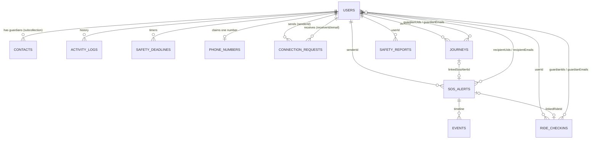

# ৫. Authentication ও Security এবং ৬. Database Design

---

## ৫. Authentication ও Security

### ৫.১ Login / Signup flow

- আলাদা "Signup" নেই — Google দিয়ে প্রথমবার sign-in করলেই Firebase Auth account তৈরি হয়, আর `_loadProfileForUser()` দেখে `users/{uid}` না থাকলে `syncUserToFirestore()` দিয়ে তৈরি করে। `[source: lib/services/auth_service.dart, _loadProfileForUser(), line ~264-269]`
- **Session handling:** Firebase Auth নিজেই session (refresh token) device-এ রাখে; app খুললে `FirebaseAuth.instance.currentUser` থাকলে `WelcomeScreen` সরাসরি `HomeScreen`-এ পাঠায়। `[source: lib/screens/welcome_screen.dart, initState(), line ~45-51]`
- **Guest mode:** `isGuest => !isAuthenticated || _isGuestMode` `[source: auth_service.dart, line ~87]`। Guest যা পারেন না (AuthGuard দিয়ে আটকানো): SOS, Safe Journey, Being Followed, Ride Check-in। `[source: lib/screens/home_screen.dart, line ~231, ~617, ~635, ~677]` Guest-এর cloud alert পাঠানো হয় না (`SosCloudDispatcher` user null হলে `null` ফেরত) `[source: lib/services/sos_cloud_dispatcher.dart, line ~37-41]`, guardian listener চলে না `[source: lib/services/guardian_alert_service.dart, line ~19-22]`।
- **Sign out:** Firebase + Google sign out, image cache, contacts cache (`contacts_cache_*`), legacy key মুছে ফেলা; activity history cloud-এ থেকে যায়। `[source: auth_service.dart, signOut(), line ~458-506]`

### ৫.২ Firestore Security Rules — লাইন ধরে ব্যাখ্যা

ফাইল: `firestore.rules` (`rules_version = '2'`)। `storage.rules` ফাইল **repo-তে নেই** — তাই Storage rules ⚠️ কোড থেকে নিশ্চিত করা যায়নি (console-এ দেখতে হবে)। এই rules ফাইলটি console-এ deploy করা হয়েছে কিনা তাও ⚠️ কোড থেকে নিশ্চিত করা যায়নি।

#### Helper function (line ~5-39)
| Function | অর্থ |
|---|---|
| `isAuthenticated()` | `request.auth != null` — login করা আছে |
| `isOwner(userId)` | login + `request.auth.uid == userId` |
| `authEmailKey()` | token-এর email lowercase করে `[^a-z0-9]` → `_` (app-এর `guardianEmailKey()` এর মতো) |
| `isAcceptedRequestToMe(requestId)` | `connection_requests/{requestId}` আছে, `status == 'accepted'` এবং receiver = আমি |
| `acceptedGuardianOf(protectedUid)` | `{protectedUid}_{myUid}` অথবা `{protectedUid}_{myEmailKey}` request আমি accept করেছি |

#### `users/{userId}` (line ~42-79)
| Rule | অর্থ |
|---|---|
| `allow read: if isAuthenticated();` | **যেকোনো login করা user যেকোনো user profile পড়তে পারে** (email দিয়ে contact খোঁজার জন্য) |
| `allow create, update: if isOwner(userId);` | শুধু নিজের profile লেখা |
| `allow delete: if false;` | কেউ মুছতে পারে না |
| `safety_deadlines/{id}`: `read, write: if isOwner(userId)` | শুধু মালিক |
| `activity_logs/{id}`: read owner; create owner ও `request.resource.data.id == activityId`; update false; delete owner এবং `type != 'sos'` | SOS history অপরিবর্তনীয় প্রমাণ |
| `contacts/{contactId}`: read শুধু owner | নিজের guardian তালিকা অন্য কেউ দেখে না |
| `contacts` create/update: owner **অথবা** (`isOwner(contactId)` && `acceptedGuardianOf(userId)`) | guardian শুধু request accept করার পর নিজের entry লিখতে পারে |
| `contacts` delete: owner, guardian নিজে, অথবা `pending_<my email key>` placeholder | |

#### `phone_numbers/{phone}` (line ~84-93)
`get` login হলে; **`list: false`** (সব নম্বর enumerate করা যায় না); create শুধু নিজের uid, `phoneNumber == phone`, field শুধু `uid, phoneNumber, createdAt`; update false; delete শুধু মালিক।

#### `connection_requests/{requestId}` (line ~96-159)
- `isSender()` / `isReceiver()` — uid বা email (camelCase/snake_case দুই ধরনের field)।
- read: sender বা receiver।
- create: login, `senderId`/`sender_uid` == আমি, `status == 'pending'`।
- update: `senderUnchanged()` (sender বদলানো যায় না) **এবং** — receiver: status `accepted`/`rejected` ও `receiverIsSelf()`; sender: status `cancelled`/`pending`।
- delete: sender বা receiver।

#### `sos_alerts/{alertId}` (line ~162-277)
- **create:** login; sender = আমি; `status == 'active'`; `ringSeq` 0; `origin` ∈ `['manual','automatic']`; `expiresAt` timestamp এবং ≤ এখন + ৩ ঘণ্টা; `triggeredAt == request.time` (server timestamp বাধ্যতামূলক — সময় জাল করা যায় না)।
- **read:** sender বা recipient (`recipientUids` বা `recipientEmails`-এ আছি)।
- **update (sender):** শুধু এই field-গুলো বদলাতে পারে — `status, resolvedAt, liveLocation, liveUpdatedAt, batteryLevel, isTrackingActive, isDuress, lastUpdatedAt, latitude, longitude, lat, lng, address, google_maps_url, location, recipientUids, recipientEmails, escalationLevel, escalationLog, recentTrail, falseAlarm, falseAlarmAt, expiresAt, ringSeq, ringAt, dismissedBy`; শেষ হওয়া alert আবার `active` করা যায় না; `dismissedBy` শুধু খালি করা যায়; `ringSeq` শুধু +১; `ringAt == request.time`; `expiresAt` ≤ এখন + ৩ ঘণ্টা।
- **update (recipient):** শুধু `status, resolvedAt, dismissedBy, acknowledgedBy, acknowledgedAt, lastRespondedAt`; status বদলালে শুধু `'resolved'`।
- **delete: false** — emergency record মোছা যায় না।
- **`events/{eventId}`:** parent alert-এর sender বা recipient পড়তে ও তৈরি করতে পারে (update/delete rule নেই = নিষিদ্ধ)।

#### `journeys/{journeyId}` (line ~280-325)
create: owner = আমি। read: owner বা guardian (`guardianUids` / `guardianEmails`)। update: owner যা খুশি; guardian শুধু `watchers.<নিজের uid>` (`name` string ≤ ৮০ অক্ষর, `at == request.time`)। delete: owner, শুধু `cancelled`/`arrived` হলে।

#### `ride_checkins/{rideId}` (line ~328-364)
create: `userId`/`ownerId` = আমি। read: owner বা guardian। update: owner যা খুশি; guardian — `userId, ownerId, guardianIds, guardianEmails` ছাড়া **যেকোনো field**। delete: false।

#### `safety_reports/{reportId}` (line ~367-379)
`read: if true` (guest-ও পড়তে পারে); create: login ও `userId == uid`; **`update: if isAuthenticated()`** — যেকোনো login user যেকোনো field বদলাতে পারে; delete false।

### ৫.৩ User ও location data কীভাবে রক্ষিত

- SOS location শুধু sender ও recipient পড়তে পারে (rules)। Journey/ride location শুধু owner ও guardian।
- Profile-এর ব্যক্তিগত তথ্য (blood group, emergency note) local disk-এ লেখা হয় না — শুধু Firestore ও memory। `[source: auth_service.dart, updateProfile() doc comment, line ~330-333]`
- PIN plain text-এ নয় — salted SHA-256। `[source: lib/services/pin_security_service.dart, line ~53-64]`
- Contacts offline cache uid-ভিত্তিক key-তে, logout-এ মুছে যায়। `[source: lib/services/contact_service.dart, purgeOnSignOut(), line ~783-807]`
- Crashlytics debug build-এ বন্ধ। `[source: lib/main.dart, line ~83]`

### ৫.৪ Security দুর্বলতা (সংক্ষেপে — বিস্তারিত `06_ISSUES_BN.md`)

1. `users` collection সব login user-এর জন্য readable → অন্যের email, phone, `fcmToken`, এমনকি profile save করলে `bloodGroup`, `emergencyNote`, `city`, `dob` পড়া সম্ভব। `[source: firestore.rules, line ~44]`, `[source: auth_service.dart, updateProfile(), line ~352-368]`
2. `safety_reports` update যেকোনো field-এ খোলা → `verifiedCount` জাল, `status` বদলানো সম্ভব। `[firestore.rules, line ~376]`
3. `ride_checkins` guardian `status` সহ প্রায় সব field বদলাতে পারে। `[line ~357-360]`
4. SOS-এ pending (অসম্মত) contact-এর email-ও recipient — তারাও alert পড়তে পারেন। `[source: lib/services/emergency_service.dart, line ~730-735]`
5. Daily report limit (৩টি) শুধু client-side। `[source: lib/services/safety_report_service.dart, line ~212-224]`
6. Gemini API key `--dart-define`-এ দিলে APK-র ভিতরে থাকে (extract করা সম্ভব)। `[source: lib/services/gemini_plate_reader.dart, line ~37]`
7. Release build debug key দিয়ে sign করা। `[source: android/app/build.gradle.kts, line ~40-44]`
8. `google-services.json` ও `lib/firebase_options.dart`-এ Firebase API key commit করা — এটা Firebase-এর সাধারণ practice (key গোপন নয়, rules-ই রক্ষা করে), তবে App Check ব্যবহার নেই (pubspec-এ `firebase_app_check` নেই)।

---

## ৬. Database Design (Cloud Firestore)

> Firestore = NoSQL document database (data থাকে collection → document → field আকারে; JOIN নেই)। Realtime Database ব্যবহার হয়নি।

### ৬.১ Collection ও field (টাইপ সহ)

**`users/{uid}`** — `[source: auth_service.dart syncUserToFirestore() & updateProfile(); notification_service.dart syncTokenToFirestore()]`
| Field | Type |
|---|---|
| `uid`, `userId` | string |
| `email`, `email_lowercase` | string (lowercase) |
| `displayName`, `name` | string |
| `photoUrl` | string |
| `phone`, `phoneNumber` | string |
| `city`, `dob`, `bloodGroup`, `emergencyNote` | string |
| `isPhoneVerified` | bool |
| `fcmToken`, `fcm_token` | string |
| `lastActiveAt` | timestamp |
| `guardianLinkMigration` | map (migration summary) `[source: guardian_link_migration_service.dart, summaryField]` |

**`users/{uid}/contacts/{contactId}`** — contactId = guardian uid / `pending_<emailKey>` / `offline_<ms>` — field: `ContactModel.toMap()` (`id, name, email, phone, relationship, isPrimaryContact, isPrimary, isBackup, contactUid, isSyncedAppUser, syncStatus ('synced'|'pending'|'offline_only'), contact_name, contact_email, contact_optional_phone, contact_uid, is_synced_app_user, sync_status, is_backup`) + accept-এর সময় `syncedAt`। `[source: lib/models/contact_model.dart, line ~74-95]`

**`users/{uid}/activity_logs/{activityId}`** — `id, type ('sos'|'siren'|'contact'|'profile'|'location'|'fakeCall'|'audio'|'ride'), title, subtitle, timestamp, metadata, timestampAt (Timestamp), createdAt`। `[source: lib/models/activity_model.dart; activity_service.dart line ~463-464]`

**`users/{uid}/safety_deadlines/{deadlineId}`** — `id, kind ('journey'|'ride'|'sos1'|'sos2'), refId, fireAt (Timestamp), direct, endOnSafe, silent, state, updatedAt`। `[source: safety_deadline_service.dart, SafetyDeadline.toFirestore(), line ~123-133]`

**`phone_numbers/{+E164}`** — `uid, phoneNumber, createdAt`।

**`connection_requests/{senderUid}_{receiverUid|emailKey}`** — দেখুন `03_FEATURES_BN.md` §4.4।

**`sos_alerts/{alertId}`** — create-এর field §4.2-এ; পরে যোগ হয়: `liveLocation, liveUpdatedAt, lastUpdatedAt, isTrackingActive, recentTrail[], escalationLevel, escalationLog[], ringAt, dismissedBy[], acknowledgedBy[], acknowledgedAt{uid: ts}, lastRespondedAt, resolvedAt, falseAlarm, falseAlarmAt`।
- `sos_alerts/{alertId}/events/{eventId}` — `type, title, description, actorName, actorUid, timestamp, metadata`।

**`journeys/{journeyId}`**, **`ride_checkins/{rideId}`** — §4.8, §4.10।

**`safety_reports/{reportId}`** — `userId, userName, incidentType, description, latitude, longitude, geohash5, geohash6, createdAt, verifiedCount, status`। `[source: lib/models/safety_report_model.dart, toMap()]`

**Firebase Storage** — `ride_checkins/{userId}/{rideId}/plate.jpg`, `.../screenshot.jpg`।

### ৬.২ Composite index (`firestore.indexes.json`)
`connection_requests` (receiverId+status+createdAt, senderId+status+createdAt); `sos_alerts` (recipientUids/recipientEmails + status / triggeredAt, senderId+triggeredAt); `journeys` (guardianUids/guardianEmails/ownerId + status + startedAt); `ride_checkins` (userId/guardianIds/guardianEmails + status + createdAt)। `[source: firestore.indexes.json]`

### ৬.৩ ER-ধাঁচের diagram

### ৬.৪ কোন screen/service কোন collection পড়ে/লেখে

| Collection | Write করে | Read করে |
|---|---|---|
| `users` | `AuthService`, `NotificationService.syncTokenToFirestore`, `PhoneVerificationService` (dead) | `ContactSyncService.searchUserByEmail`, `SosCloudDispatcher`, `ContactService.getContacts` (phone back-fill), `ProfileScreen` |
| `users/*/contacts` | `ContactService`, `ContactSyncService` (accept-এ guardian লেখে) | `ContactService` (stream), `EmergencyService`, `SosCloudDispatcher`, `ContactsScreen` |
| `users/*/activity_logs` | `ActivityService` | `ProfileScreen`, `SettingsScreen`, `SosHistoryScreen` (via `ActivityService`) |
| `users/*/safety_deadlines` | `SafetyDeadlineService` | `SafetyDeadlineService.resyncFromCloud` |
| `phone_numbers` | `PhoneRegistryService` | `PhoneRegistryService` |
| `connection_requests` | `ContactSyncService` | `ContactSyncService`, `GuardianAlertService.kt`, `GuardianLinkMigrationService` |
| `sos_alerts` (+events) | `SosCloudDispatcher`, `LiveTrackingService`, `SosEscalationService`, `NotificationService` (ack/dismiss), `AlertActionReceiver.kt`, `BatteryAlertService` | `NotificationService`, `GuardianAlertService.kt`, `InboxService`, `IncidentRoomScreen`, `SosHistoryScreen`, `EmergencyService` |
| `journeys` | `JourneyService`, `LiveTrackingService`, `EmergencyService._linkActiveJourney` | `NotificationService`, `GuardianAlertService.kt`, `InboxService`, `JourneyTrackingScreen` |
| `ride_checkins` | `RideCheckinService`, `LiveTrackingService` | `NotificationService`, `GuardianAlertService.kt`, `InboxService`, `RideDetailsScreen`, `RideHistoryScreen`, `ActiveRideScreen` |
| `safety_reports` | `SafetyReportService` | `SafetyReportService` → `MapScreen` |

> লক্ষ্য করুন: অনেক field দুইবার আছে (camelCase ও snake_case — যেমন `senderId` ও `sender_uid`)। Code-এর comment অনুযায়ী এটা "Firestore compatibility fields" — পুরনো version ও Cloud Function দুই ধরনের নাম পড়ে বলে। `[source: lib/models/contact_model.dart, line ~86]`
