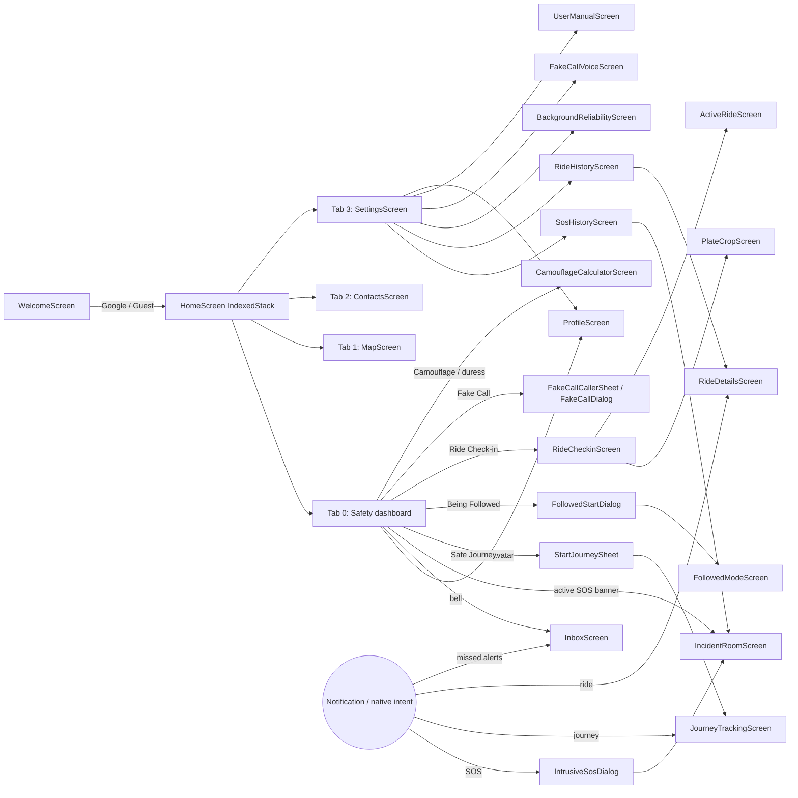

# ৭. Navigation ও Screen তালিকা · ৮. Background, Notification ও Device Integration · ৯. Build, Run ও Setup

---

## ৭. App Navigation ও Screen তালিকা

### ৭.১ Routing পদ্ধতি
- **Named route / GoRouter ব্যবহার হয়নি** — `pushNamed`, `routes:`, `onGenerateRoute`, `GoRouter` কোথাও নেই (grep: 0)।
- ব্যবহৃত: `Navigator.push(MaterialPageRoute(...))`, `PageRouteBuilder` (fade/slide transition), `Navigator.pushReplacement` (Welcome → Home), `showModalBottomSheet`, `showDialog`। `[source: lib/screens/welcome_screen.dart, _navigateToHome(), line ~61-70]`, `[source: lib/screens/home_screen.dart, _openProfile(), line ~189-207]`
- Home-এ ৪টি tab **`IndexedStack`** দিয়ে (tab বদলালেও state থাকে): `0 Safety` (dashboard), `1 Map`, `2 Contacts`, `3 Settings`। `[source: home_screen.dart, build(), line ~720-740; _AppBottomNav, line ~3563-3603]`
- **Global navigator key** `rootNavigatorKey` — notification বা native callback থেকে (context ছাড়া) dialog/screen খোলার জন্য। `[source: lib/main.dart, line ~27, ~167]`
- Camouflage: `MaterialApp.builder`-এ পুরো app-এর উপর `CamouflageCalculatorScreen` বসে। `[source: lib/main.dart, line ~176-186]`

### ৭.২ Screen তালিকা

| Screen (file) | উদ্দেশ্য | কী দেখায় | কোন service ডাকে |
|---|---|---|---|
| `lib/screens/welcome_screen.dart` | প্রথম screen | logo, "Continue with Google", "Explore as Guest" | `AuthService.signInWithGoogle/continueAsGuest` |
| `lib/screens/home_screen.dart` | মূল shell + Safety dashboard | SOS বোতাম, active SOS banner ও delivery status, Quick Actions (Fake Call, Loud Siren, Safe Journey, Ride Check-in, Camouflage, Silent Panic, Being Followed), location card, incoming journey/ride card, bell | `EmergencyService`, `SirenService`, `JourneyService`, `NotificationService`, `ShakeSosService`, `MotionDetectionService`, `BatteryAlertService`, `Esp32BleService`, `PinSecurityService`, `LocationService` |
| `lib/screens/map_screen.dart` | Safety map | OSM/CARTO tile, safe zone marker, risk heatmap, report | `SafetyReportService`, `SafeZoneRepository`, `LocationService`, `NavigationService` |
| `lib/screens/contacts_screen.dart` | Contacts | নিজের guardian তালিকা, pending request, "People I Protect" | `ContactService`, `ContactSyncService` |
| `lib/screens/settings_screen.dart` | Settings | toggle ও sub-screen | `ShakeSosService`, `BatteryAlertService`, `MotionDetectionService`, `SosEscalationService`, `PinSecurityService` |
| `lib/screens/profile_screen.dart` | Profile | তথ্য, stats, activity | `AuthService`, `PhoneRegistryService`, `ActivityService` |
| `lib/screens/incident_room_screen.dart` | SOS কমান্ড সেন্টার | live map, timeline, safe zone, Call 999 | `IncidentService`, `NotificationService.acknowledgeAlert`, `EmergencyService.markSafe`, `NavigationService` |
| `lib/screens/sos_history_screen.dart` | SOS ইতিহাস | পাঠানো/পাওয়া alert | Firestore `sos_alerts` সরাসরি, `NotificationService.dismissAlert` |
| `lib/screens/inbox_screen.dart` | Notification inbox | alert/journey/ride history | `InboxService` |
| `lib/screens/start_journey_sheet.dart` (bottom sheet) | Safe Journey শুরু | destination search, route preview, guardian | `PlaceSearchService`, `RouteService`, `JourneyService.startJourney` |
| `lib/screens/journey_tracking_screen.dart` | Journey live view (traveler/guardian) | map, ETA | Firestore `journeys`, `JourneyService` |
| `lib/screens/followed_mode_screen.dart` | Followed Mode | map, nearest police, siren, I'm safe | `JourneyService`, `SafeZoneRepository`, `NavigationService`, `SirenService` |
| `lib/screens/ride_checkin_screen.dart` | Ride শুরু | ছবি/OCR form | `RideOcrService`, `RideCheckinService` |
| `lib/screens/plate_crop_screen.dart` | plate crop | ছবিতে box টানা | — (ফলাফল ফেরত দেয়) |
| `lib/screens/active_ride_screen.dart` | চলমান ride (traveler) | map, arrived/extend/cancel/SOS | `RideCheckinService`, `EmergencyService` |
| `lib/screens/ride_details_screen.dart` | Ride guardian view | vehicle info, live map | Firestore `ride_checkins`, `NavigationService` |
| `lib/screens/ride_history_screen.dart` | Ride ইতিহাস | তালিকা | Firestore `ride_checkins` |
| `lib/screens/camouflage_calculator_screen.dart` | ছদ্মবেশী calculator | কাজের calculator | `PinSecurityService` |
| `lib/screens/fake_call_voice_screen.dart` | নিজের caller voice record | record/play/delete | `FakeCallSettingsService`, `record`, `audioplayers` |
| `lib/screens/background_reliability_screen.dart` | Background setup guide | exact alarm, battery | `SafetyDeadlineService` |
| `lib/screens/user_manual_screen.dart` | ব্যবহার নির্দেশিকা | text | — |

গুরুত্বপূর্ণ dialog/sheet (`lib/widgets/`): `intrusive_sos_dialog.dart` (guardian-এর SOS dialog), `safety_check_dialog.dart` ("Are you OK?" ও fall check), `pin_input_dialog.dart`, `add_contact_dialog.dart`, `esp32_scan_sheet.dart`, `fake_call_dialog.dart`, `fake_call_caller_sheet.dart`, `followed_start_dialog.dart`, `report_unsafe_spot_sheet.dart`, `login_required_bottom_sheet.dart`, `pending_requests_section.dart`, `active_journey_card.dart`, `incoming_journey_card.dart`। (`phone_verification_modal.dart` — কোথাও ব্যবহৃত নয়)

### ৭.৩ Screen flow diagram

---

## ৮. Background Tasks, Notifications ও Device Integration

### ৮.১ Background কাজের তালিকা

| Mechanism | কী করে | Platform | উৎস |
|---|---|---|---|
| `flutter_background_service` foreground service (notification id `888`) | process জীবিত রাখে, notification text বদলায় (SOS/journey/ride/duress ছদ্মবেশ) | Android (iOS config আছে কিন্তু `onIosBackground` শুধু `true` ফেরত দেয়) | `lib/services/background_service.dart`, line ~18-62, ~93-171 |
| `GuardianAlertService.kt` (specialUse FGS, `stopWithTask=false`) | guardian-এর SOS/ride/journey listener | Android | §4.3 |
| `GuardianWatchdogReceiver.kt` | প্রতি ১০ মিনিট alarm, service restart/reconnect | Android | line ~29 |
| `GuardianBootReceiver.kt` | boot/update-এর পর deadline, pendant, guardian service | Android | — |
| `SafetyDeadlines.kt` + `SafetyDeadlineReceiver.kt` + `SafetyDeadlineService.kt` + `DeadlineDartRunner.kt` | exact alarm → headless Dart SOS | Android | §4.11 |
| `PendantLinkService.kt` + `PendantWatchdogReceiver.kt` | ESP32 BLE সংযোগ বজায় | Android | §4.12 |
| Geolocator position stream | live tracking | main isolate (FGS দিয়ে বাঁচানো) | §4.5 |
| Accelerometer stream | shake / fall | main isolate | §4.13-4.14 |
| `Timer.periodic` | journey monitor ৩০s, ride overdue ৩০s, contact heartbeat ৪s, SOS listener heartbeat ৪s, battery ৯০s | Dart | বিভিন্ন service |

### ৮.২ Notification channel (Android) — হুবহু id

| Channel id | নাম | কে তৈরি করে |
|---|---|---|
| `sos_emergency_channel` | SOS Emergency Alerts (status, FGS) | `NotificationChannels.kt` (`SOS_STATUS`) |
| `sos_emergency_channel_v2` | SOS Emergency Alerts (siren sound `siren`) | `notification_service.dart` line ~413 |
| `safety_check_channel` | Safe Journey Safety Checks | `notification_service.dart` line ~427 |
| `followed_mode_checks_channel` | Followed Mode Check-ins (শব্দহীন) | Dart + Kotlin উভয় |
| `ride_safety_alerts_channel_v2` | Ride Safety Alerts | Dart + Kotlin |
| `ride_checkin_channel` | Ride Safety Check-in (legacy) | Dart |
| `guardian_protection_channel` | Woman Guard Protection (low) | Kotlin |
| `guardian_emergency_alerts_channel` | Emergency Alerts (channel নীরব; siren আলাদা বাজে; `setBypassDnd(true)`) | Kotlin |
| `guardian_missed_alerts_channel` | Missed Emergency Alerts | Kotlin |
| `safety_deadline_checks_channel` | Safety Checks | Kotlin |
| `journey_guardian_alerts_channel` | Safe Journey Alerts | Kotlin |

`[source: android/app/src/main/kotlin/com/smartsafety/smart_safety/NotificationChannels.kt, line ~18-42]`, `[source: lib/services/notification_service.dart, line ~413-477]`

### ৮.৩ Push notification (FCM)
- App FCM token নেয় ও `users/{uid}`-এ `fcmToken`/`fcm_token` রাখে; `onMessage` / `onMessageOpenedApp` handler আছে (`SOS_ALERT`, `RIDE_CHECKIN` type)। `[source: notification_service.dart, line ~503-584]`
- **কিন্তু push পাঠায় কে?** শুধু `functions/index.js` — যা Spark plan-এ deploy হয় না। তাই বাস্তবে FCM handler-গুলো সক্রিয় হওয়ার উৎস নেই; alert পৌঁছায় Firestore listener দিয়ে। ⚠️ কোড থেকে নিশ্চিত করা যায়নি — Functions আসলে deploy আছে কিনা (Firebase console → Functions দেখুন)।
- Manifest-এ FCM default channel `sos_emergency_channel`। `[source: AndroidManifest.xml, line ~52-54]`

### ৮.৪ Local notification
`flutter_local_notifications` — SOS banner (full-screen intent, Call / View Map action), safety check (ongoing, ৬০s), status (escalation, auto-SOS), ride, guardian request। Background action handler `notificationTapBackground()` (`@pragma('vm:entry-point')`)। `[source: notification_service.dart, line ~29-64, ~1096-1419]`

### ৮.৫ SMS পাঠানোর পদ্ধতি — তিন স্তর
1. **Native `SmsSender.kt`** (primary SOS round ও follow-up) — dual-SIM, multipart, sent-confirmation।
2. **`telephony` plugin** — "I'm safe", escalation, journey/followed/ride/battery SMS, এবং native না থাকলে fallback।
3. **Messages app composer** (`ACTION_SENDTO smsto:`) — permission নেই বা fail হলে; background-এ থাকলে notification। Samsung-এ recipient separator `,`, অন্যদের `;`। `[source: SmsSender.kt, line ~241-243]`

### ৮.৬ Hardware/sensor trigger
| Trigger | আছে? | কোথায় |
|---|---|---|
| ESP32 BLE button | ✅ | §4.12 |
| Shake (accelerometer) | ✅ (default off) | §4.13 |
| Fall (accelerometer) | ✅ (default off) | §4.14 |
| Volume/power button | ❌ নেই — কোনো `KeyEvent`/volume listener code নেই | — |
| Voice trigger | ❌ — `EmergencyService`-এর comment-এ "Voice" উৎসের উল্লেখ আছে (`sosInProgressNotifier` doc), কিন্তু কোনো speech/voice package বা call নেই | `emergency_service.dart`, line ~244-246 |

### ৮.৭ Android বনাম iOS — সারসংক্ষেপ

| বিষয় | Android | iOS |
|---|---|---|
| Native SMS auto-send | ✅ | ❌ (`telephony` Android-only; iOS-এ auto SMS সম্ভব নয়) |
| Guardian background listener | ✅ native service | ❌ নেই |
| Safety deadline exact alarm | ✅ | ❌ (`claim()` সবসময় true; native scheduler নেই) |
| ESP32 background link | ✅ `PendantLinkService` | ⚠️ in-app connection মাত্র; `NSBluetoothAlwaysUsageDescription` নেই |
| Google Sign-In | ✅ | ⚠️ URL scheme / `GoogleService-Info.plist` নেই |
| `Info.plist` | — | ❌ **valid XML নয়** — `UISupportedInterfaceOrientations~ipad`-এর `<array>` বন্ধ হয়নি (Python XML parser: "mismatched tag: line 92") |
| Podfile | — | repo-তে নেই (`flutter` প্রথম build-এ তৈরি করে) |

**উপসংহার:** এই app কার্যত **Android-only**। iOS build বর্তমান অবস্থায় সফল হবে বলে কোড থেকে নিশ্চিত করা যায় না (⚠️ — Info.plist XML ত্রুটি)।

---

## ৯. Build, Run ও Setup

### ৯.১ Android SDK
| বিষয় | মান | উৎস |
|---|---|---|
| `minSdk` | `flutter.minSdkVersion` = **24** (Flutter 3.41.9 tools-এর `FlutterExtension.kt`) | `android/app/build.gradle.kts` line ~32; Flutter SDK |
| `targetSdk` | `flutter.targetSdkVersion` = **36** | একই |
| `compileSdk` | `flutter.compileSdkVersion` = **36** | একই |
| NDK | `flutter.ndkVersion` = `28.2.13676358` | একই |
| Java/Kotlin target | 17 | `build.gradle.kts` line ~19-24 |
| Core library desugaring | চালু | line ~18 |
| multiDex | true | line ~36 |
| Release signing | **debug key** (TODO) | line ~38-44 |
| iOS deployment target | 13.0 | `ios/Runner.xcodeproj/project.pbxproj` |

> ⚠️ minSdk/targetSdk সরাসরি project-এ লেখা নেই — Flutter SDK version বদলালে বদলে যাবে। মানগুলো এই machine-এর Flutter 3.41.9 থেকে পড়া।

### ৯.২ Setup ধাপ
1. Flutter (≥ 3.41) ও Android SDK install।
2. `flutter pub get`
3. **Firebase:** `android/app/google-services.json` repo-তে আছে (project `womens-safety-aa3ef`, package `com.smartsafety.smart_safety`, ২টি OAuth client)। Google Sign-In-এর জন্য নিজের debug/release **SHA-1** Firebase console-এ যোগ করতে হবে (code-এর error message-ই বলে: "Make sure the SHA-1 fingerprint is registered in Firebase Console.") `[source: lib/services/auth_service.dart, line ~434-437]`
4. Firestore rules/index deploy: `firebase deploy --only firestore` (`firebase.json`-এ `firestore.rules`, `firestore.indexes.json` নির্দেশিত)।
5. **ঐচ্ছিক Gemini key:** `secrets.example.json` কপি করে `secrets.json` (gitignored) → `{"GEMINI_API_KEY": "...", "GEMINI_MODEL": "gemini-3.5-flash"}` → `flutter run --dart-define-from-file=secrets.json`। Key না দিলে শুধু on-device OCR। `[source: secrets.example.json]`, `[source: .gitignore]`, `[source: lib/services/gemini_plate_reader.dart, line ~29-38]`
6. Run: `flutter run` (Android device, real SIM সহ — SMS test-এর জন্য)।
7. ESP32: Arduino IDE → "esp32 by Espressif Systems" → `esp32_firmware/esp32_woman_guard_pendant.ino` upload (README অনুযায়ী)।
8. Test: `flutter test` (৪২টি Dart test ফাইল); Firestore rules test `test/firestore_rules/*.test.mjs` (Firebase emulator লাগবে)।
9. Release: `flutter build apk` — কিন্তু নিজের keystore দিয়ে signing config যোগ করা উচিত।

### ৯.৩ প্রয়োজনীয় key (মান প্রকাশ করা হয়নি)
| Key | কোথায় | গোপন? |
|---|---|---|
| Firebase Android/iOS API key | `google-services.json`, `lib/firebase_options.dart` | না (Firebase client key; rules দিয়ে সুরক্ষিত) |
| Google `serverClientId` (web OAuth client) | `auth_service.dart` line ~54-55 | না |
| `GEMINI_API_KEY` | build-time `--dart-define` | হ্যাঁ — কিন্তু APK-তে ঢুকে যায় |

### ৯.৪ Code quality check (এই বিশ্লেষণের সময় চালানো)
- `flutter analyze` → **"No issues found! (ran in 80.8s)"**
- Test ফাইলে `test(`/`testWidgets(` মোট ৪২৩টি occurrence (grep count; প্রকৃত test সংখ্যা কাছাকাছি)। `flutter test` চালানো হয়নি (read-only বিশ্লেষণ) — ⚠️ সব test pass করে কিনা নিজে চালিয়ে দেখুন।
